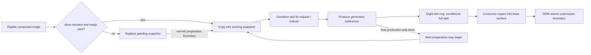

# A9 composer scheduling and snapshot ownership

**Date:** 2026-10-12. **Status:** reviewed host findings for the user-space normal composed-image path.

Ordinary composed targets replace one pending owned snapshot while software production continues. The next
target may be prepared after production finishes, before prior subframes drain. Generated subframes use a
separate bounded ring with a full-wait predicate under normalized steady-state assumptions. Startup
protection, real concurrency, downstream cancellation/completion and panel response remain unproven.

## Identity and capture route

Input: private `vendor/vendor.qti.hardware.display.composer-service`, SHA256
`8c89557bf47b57b1687b9fbcc3e55bedbee175d20f80d14bc5317fcf893df5ed`. Addresses below are ELF virtual addresses,
not live ASLR addresses. Function identities were resolved from `.gnu_debugdata`; independently extracted
debug ELF SHA256 is `f4511694cec38c4767e31e056ae090837d0ac6c9640c7d5ffbeb3314ed83debd`. See [behavior
notes](a9-composer-behavior.md) for conditioning and requests.

`HWCDisplayBuiltIn::Present` at `0x1b0f78` calls virtual slot `+0x3c0` at `0x1b1194`; relocation `0x1eb110`
resolves to built-in `CommitLayerStack` at `0x1b3418`, whose tail branch `0x1b3584` reaches
`HWCDisplay::CommitLayerStack` at `0x1a2ad0`. Other Present branches can skip it. Capture requires object byte
`+0x6bb`, waits the source acquire fence, checks logical width 824/height 1648 and selects the penultimate
stack entry. Byte `+0x7c8` limits acceptance to one image in that call. A missing mapped handle pointer at
`+0x54` must first pass `MapBuffer` at `0x1a2f70`.

The gate `0x1a2efc..0x1a2f08` reads `done=byte[this+0x6bc]` and `ready=byte[this+0x6b8]`. These are
zero/nonzero tests:

| Route | Predicate | Copy and publication |
| --- | --- | --- |
| Working | `done != 0 && ready == 0` | Copy to pointer `+0x688` at `0x1a3018`; halfword 1 at `+0x6b8` sets ready and clears pending; broadcast `+0x598` under mutex `+0x4c0` |
| Pending | Otherwise | Lock `+0x4e8`; copy to pointer `+0x690` at `0x1a2f34`; set pending byte `+0x6b9`; unlock |

Both copy `0x53b000` (5,484,544) bytes into separately owned allocations, reusing storage rather than
retaining Android handles or allocating FIFO nodes. This extent equals `824*1664*4`; it does not establish the
allocator's stride contract. Bitmap byte `+0x6c4 != 0` skips either copy/publication while still marking
`+0x7c8` accepted. Bitmap controls need separate analysis.

## Preparation, production and consumer milestones

In `EinkSwTconThreadHandler` (`0x1a5acc`), `done==0` at `0x1a5cb4` returns to production at `0x1a7b4c`,
bypassing promotion regardless of pending. Normal promotion at `0x1a614c..0x1a617c` tests pending, locks
`+0x4e8`, copies pending to working and clears pending; pointers are not swapped. Without pending,
`0x1a677c..0x1a67b0` clears ready and waits on `+0x598` under `+0x4c0`. Preparation has done/ready nonzero, so
incoming targets take the pending route too. Done is cleared at `0x1a7b38` before production.

Old-level pointer `+0x7d0` receives new-level `+0x7e8` at `0x1a7a34..0x1a7a44`, before production/submission.
It is software transition history, not measured panel state. Request `S=this+0x19e7418` and base indices
`+0x7d8` are published at `0x1a7a64/0x1a7a70`. Active normal production keeps that request; the inspected
ordinary capture paths request no cancellation or restart. Final publication stores W at `0x1a7e18`, sets done
at `0x1a7e44` and logs produced count at `0x1a7e48`, without waiting for ring drain. Done means produced, not
drained, successfully submitted or physically complete.

Ring descriptor k is `this+0x600+16*k`, k=0..7, holding a pointer and size `0x16ab00` (1,485,568 bytes). W/R
are signed words `+0x5fc/+0x5f8`. Producer `0x1a7b84..0x1a7bb8` waits while `next=(W+1)%8 == R` on `+0x568`
with mutex `+0x498`; `0x1a7c38..0x1a7c60` rechecks after unlock. With coherent single-producer/single-consumer
indices in 0..7, this reserves a boundary slot and bounds outstanding modulo distance to seven. Full waits
stop production rather than replace the next queued generated frame.

`EpdUpdateThread` body `0x1a4c74` waits while W==R using `+0x470/+0x538`. Normal dispatch `0x1a55d8..0x1a5604`
advances R before copying the slot. `GRSurfaceDrm::data` (`0x1c7f00`) returns surface storage; conversion/copy
`0x1a56b8..0x1a56d0` covers `0x5aac0` words. Consumer signals the producer after copying, then calls
`MinuiBackendDrm::Flip` (`0x1caee4`) at `0x1a5720`. Flip calls `drmModeAtomicCommit` at `0x1cb018` with flags
`0x400` and rotates draw surfaces even along its error path. It consumes no page-flip event or panel
measurement. A returned surface does not establish successful submission.

## Equality, sequence clock and limits

Duplicate suppression at `0x1a6ed4..0x1a6ef8` requires all three gates: normal byte `+0x6c7 != 0`, request
kind `S+0 == 0`, and equal `0x14b880` bytes between new-level `+0x7e8` and prior-comparison `+0x698`. It
compares rotated raw luma **before** conditioning, not final target nibbles:
the snapshot copy at `0x1a729c..0x1a72ac` precedes ReadingModeDetect and local
conditioning (Review `sol-rea-eink`, 2026-10-16). It neither compares pigment
nor certifies successful drain. Patch 0040 deliberately adds a stronger
complete-final-target equality check on our successfully committed history;
that target-level suppression is an extension, not the observed stock predicate.

`lookUpTable` (`0x1d1690`) uses shared counter `0x4c7fbc` to select a common sequence column; pixel loops read
uint16 transition indices without updating pixel-local time budgets. Continuation is at `0x1d1a9c..0x1d1ab4`.
Gate bit 0 at `0x4c7fb8`, rather than the entire byte, selects regular lookup; gate 0 uses the separate
sequence at `0x1a7d04` and the same ring. Different transition-row lengths do not prove independent per-pixel
software timers. See the [request model](a9-composer-requests.md) and [table
inventory](a9-composer-tables.md).

R/W initialize and reset to -1 at `0x19ed44/0x1a4b5c`. With R held at -1, neither full predicate matches
normalized next; nine fabricated publications can select `0,1,2,3,4,5,6,7,0`. This proves a predicate
boundary, not an observed startup overwrite. Universal ring losslessness is unproven; target coalescing
already discards intermediate composed targets by design.

Predicate reads and several flag/index writes occur outside the copy/wait mutexes using ordinary loads/stores.
Pending is tested before its copy lock; capture tests done/ready before copy/wake locking. The review does not
establish data-race freedom, exclude crossing races/missed wakeups or bound latency. Power, pause, bitmap,
shutdown, driver behavior and current ReadingMode remain outside these normal-path conclusions.

Host experiments should separate acceptance, pending replacement, production and consumer/submission.
Target changes and [saved-log counts](epd-offline-log-report.md) cannot establish optical speed or completion;
concurrent scheduling and synchronized optics need their own evidence.

## Private evidence and reproduction

Evidence root: `/home/user/source/a9-display-evidence-20261012` (outside Git).
`COMPOSER-SCHEDULING-SOL-20261012.txt` SHA256
`ac0be35bd6e38a81540b8988b82dc641164f96fd0daa5745ece9516eb42e6586`. Durable independent bundle:
`derived/scheduling-independent-review/`; `a9-scheduling-independent-review-20261012.txt` SHA256
`9dab33d9ff8559af8367788c21e36116a2a7ffb8964f233337b39bc980b1fdb1`. Its `RUN-INSTRUCTIONS.txt` and
`SHA256SUMS` pin extraction, identity and probes.

Capstone/ELF review and bounded Unicorn snippets independently checked capture, promotion, both ring
predicates, duplicate gates, producer dispatch and every byte of the consumer surface copy. Copy/equality use
host stubs; waits/locks are recorded no-ops, and producer-dispatch lookup is stubbed for continuation.
Real threads, driver/syscalls and Flip are not executed. Reproduce in a scratch copy to preserve accepted
outputs. These are isolated path checks, not end-to-end emulation; vendor bytes and traces stay outside Git.
