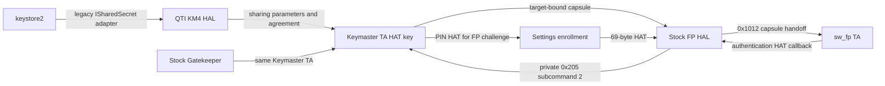

# PIN to fingerprint enrollment preflight

INTEG27 prep follow-up: stock Sunwave template storage now traces through the
32-bit common library to the GP filesystem listener and user0 fpdata directory.
No additional RPMB partition allowance or persist write is needed for that
selected template path. The appended current comparison records evidence,
remaining runtime checks and the new root3 open diagnostics.

INTEG25 follow-up: main's `d40c4c2` permits existing GK-partition writes while
keeping KMTB, RPMB metadata and key programming protected. PIN success and
fingerprint enrollment on that image are still unverified. The sections below
retain their dated stock/INTEG22 evidence; the new PIN handoff and storage checks
prepare the next coordinator-owned user session. No phone operation is run by
this host preflight.

Host-only stock-code, framework and installed-policy review. No phone access,
PIN/HAT submission, enrollment, authentication, TA execution or credential-store
read occurred. The examined FP service/HAL in INTEG22 match stock byte-for-byte;
agent owns INTEG23 and its library closure. Main's `ee79d2f` repairs vendor
namespace exposure; this review adds no speculative replacement provider,
permission or HMAC-agreement implementation.

The KM4 agreement route exists. Stock fingerprint obtains an opaque,
target-bound HAT-key capsule through a separate vendor command. A conditional
ordering risk remains: agreement can replace the key after an earlier FP
export. Actual startup order and successful enrollment remain unproved.

## Are templates encrypted? Stock Sunwave REA, 2026-10-25

**Yes for the normal selected FTS1 template payload.** In `sw_fp`,
`sf_save_one_template` **0x30cac** calls `sf_file_write` **0x31a50**, which
requires encryption and MAC success before sending a blob to the GP filesystem
listener. There is no plaintext fallback in that branch. Consequently the normal
`/data/vendor_de/0/fpdata/sf_template_<opaque>.bin` payload and its filesystem
backup are ciphertext. This is a code-path finding; no actual template was read.
The file is not ciphertext in every byte: it contains clear length4, MAC32,
random IV16, then encrypted payload, at offsets0,4,0x24,0x34. The MAC covers
IV+ciphertext; that call does not cover the clear length. Other fpdata files
include `user_id.dat`: HAL **0x15658c** writes88 bytes of association bookkeeping
without this template encryption.

**Keys:** common-library **0x23a70** derives separate32-byte cipher/MAC keys
with null-key `qsee_kdf`, distinct `GP Persistent Object Cipher` and
`GP Persistent Object Hmac` labels/contexts, and caches them in the TA context.
These are separate from the Keymaster-exported HAT key. Stock TZ singleton11
factory **0x1006a700 ->0x1005f9e8** derives an application key using the app's
32-byte `did` property and `core trustzone application key label securemsm`;
method1 at **0x1005fc5c** substitutes that key for null-key derivation requests.
The normal root derivation **0x10039dfc ->0x1004f1a0 ->0x1004f4d0 ->0x10047c78**
selects the crypto engine's internal key source rather than supplied key bytes;
**0x10048960** programs that selection. This supports application-bound,
hardware-derived keys in normal QSEE mode, without identifying the exact fuse
key. **0x1003a0cc** also has an alternate KDF branch controlled by QSEE state
bit0x17; its live value was not observed. No explicit key-version argument was
found. Template format **7** is inside the encrypted payload and does not prove
versioned keys; the `did` construction/version policy remains unverified.

**Plaintext debug output exists.** HAL `dumpData` **0x156f10** can write BMPs,
sensor `.bin` files and calibration data under `/data/vendor_de/fsfp_dump`,
including `templet` images. BMP writer **0x12c1e0** and sensor writer **0x12d630**
write unencrypted data. Normal event dumps are gated at **0x159d08**; defaults
and stock XML disable them, and loader **0x143b18** clears debug flags on `user`
unless `persist.sys.sw.dbg.en` permits overrides. This is not a universal ban:
factory `captureTest` **0x16ca1c** exports a BMP to a supplied path without that
check in its body; calibration commands at **0x1618d4** can also export directly.
Runtime caller reachability was not established. A named template-dump command
alone does not prove plaintext serialized-template export. Thus ordinary
persistence is sealed, but “biometric data never leaves the TEE in plaintext”
is false as a claim about all compiled stock paths.

TA/HAL addresses use the bases already specified below; common-library mapping
is in the FTS section; TZ addresses above are original VAs. Retained evidence:
`ev_24ed751039ed71a9a3931bf177352da184f77144e5aad755f47b4f2714410059`
(template wrapper),
`ev_b8930e8ef6ed0c8106b410124aecc11e3f6e4979b609ce3c94ac273d4ae70dbf`
(key derivation),
`ev_abd77aefc950641e319ab249d1c52c008f4cfdb299beea3a9f4e0401af8ff5e3`
(app key),
`ev_422c3139f4e8b0c335c1643e26302f502b2d01d7fee8a5804679ea33b9c90f48`
(debug writer),
`ev_bbf97a2180f0adc8c7192b808aacb63387e1464398018da8540d277dfa76a673`
(factory capture). This is host static analysis, not live dump-file inspection
or a complete TEE security audit.

## Mainline dump prevention on development images

The INTEG27 system and vendor are `userdebug`. Its selected XML already disables
`data_dumping`/`img_invciper_data`, but the unmodified HAL's
`testing.sw.dbg.dump=1` override can enable dumping without the `user` closure.
No runtime dump activation or existing biometric file contents were inspected.

The credentials vendor overlay now applies three length-preserving string
substitutions to the exact pinned HAL donor: its loader reads private read-only
`ro.vendor.fp=user`, `ro.vendor.fp.debug=0`, `ro.vendor.fp.dump=0` instead of the
build-type, engineering-debug and testing-dump properties above. Thus it always
executes stock loader0x143b18's debug-closing branch, including on `userdebug`.
HAL instruction sections and all TA bytes are unchanged; global Android build
identity stays truthful. XML explicitly disables image, raw sensor, SPI and
bad-point debug switches and retains stock user log level2. Unknown HAL donors
and partial patches are rejected by the host builder.

Init precreates `/data/vendor_de/fsfp_dump`0555 root:root and restores the
separate `a9_fp_dump_file` label. Filename transition also prevents HAL creation
before that action. Effective policy denies HAL and `tee` create/write/append
access there; HAL neverallow assertions document the restriction. The inherited
compiler uses `-N`, so host decision queries, rather than that switch-disabled
assertion alone, verify denial. Normal encrypted fpdata write access remains.
Existing dumps are retained for detection, never exported or deleted. Compiled
factory methods still exist; this is not a claim to remove arbitrary-path
factory exports throughout the HAL.

Sweep row **`30_fp_no_dumps`** inventories the root before feature tests and
again after final PIN/restart work. It fails on any non-directory entry,
symlink root or scan error and retains earlier failures. Only numeric file/error/
scan counts leave the command; no payloads or names are read/exported. The row
never vetoes independent feature tests. `build14.py` refreshes the overlay and
bundles the new inventory script for both development and release builds.

## Two related key paths

Fingerprint HIDL is not another framework `ISharedSecret` participant. Gatekeeper
also uses the existing Keymaster TA, rather than negotiating a second Android
userspace HMAC secret. Do not add a fake shared-secret service or move key
material into Android userspace to connect these paths.

## Keystore2 does negotiate with legacy KM4

The pinned [AOSP Android16 negotiation implementation](https://android.googlesource.com/platform/system/security/+/ce2aa0ef49158d0d45fb133fd42ab1deff210f8c/keystore2/src/shared_secret_negotiation.rs)
discovers HIDL Keymaster4.1/4.0 instances named `default` or `strongbox`, keeps
the highest version once per security level, and appends declared AIDL shared
secret services. A lone TEE participant still gets the agreement call. It
obtains legacy participants through the compatibility service; no extra vendor
AIDL shared-secret HAL is required for this KM4 device.

The [compatibility adapter](https://android.googlesource.com/platform/system/security/+/ce2aa0ef49158d0d45fb133fd42ab1deff210f8c/keystore2/src/km_compat/km_compat.cpp#1009)
forwards `getSharedSecretParameters` to `getHmacSharingParameters`, and
`computeSharedSecret` to `computeSharedHmac`, converting parameter vectors and
propagating errors. Keystore collects and sorts all seed/nonce pairs, computes
on each participant and compares returned sharing checks. The existing QTI
provider sends these to the TA with modern commands0x220e/0x220f, or legacy
0x20e/0x20f; see [Keymaster REA](mainline-fbe-pin.md).

This is corroborated in the actual selected GSI: keystore2 links
`libkm_compat_service.so`; `libkm_compat.so` implements the two adapters and
the security-level shared-secret cache. Its Ghidra addresses are0x126168,
0x1265d4 and0x12e150 respectively. Evidence:
`ev_886aa42b06e3263116a1e3469b3dfffc817c8d2e9ff72db5accbe6fa74e936cf`,
`ev_4e76759e7ca28e185d9c85b4a8696c27c8e2dc69d864c32097961feabfc35442`,
`ev_4fbbb96ea0b803743f20c1bae78c7d1aff312eca0608edbbe7c5d3120eb16b64`.
Actual keystore symbols also identify negotiation and participant enumeration.
No missing adapter was found. Actual participant availability, call success and
sharing-check results still require runtime evidence.

The reference implementation starts negotiation asynchronously, so it is not a
fingerprint-startup join barrier. Also, its phase-two errors only log; the outer
thread subsequently emits its success message unconditionally. That message
alone is insufficient evidence. This error-flow observation is from the pinned
reference, whose revision differs from the shipped GSI; the corresponding
actual keystore body was not decompiled, so identical behavior is not assumed.

## Stock FP capsule handoff and ordering

Stock HAL SHA256 is
`5e2bbcf3458a251786a14ba3b01c17c8f6c79017c0eec0071a574f55719ed193`.
Addresses below use Ghidra base0x100000; subtract it for ELF virtual addresses.

At **0x170f2c**, `sf_trustlet_client_open_session` searches for `sw_fp.b00` in
`/vendor/firmware`, `/vendor/firmware_mnt/image`, `/system/etc/firmware` and
`/firmware/image`. It starts `sw_fp` with a1MiB shared buffer, sends0x1000,
then calls **0x171b48**. That helper opens `keymaster` with `keymaster64`
fallback and requests private command0x205/subcommand2. The HAL passes the
returned capsule to `sw_fp` with0x1012 and clears its temporary response.
Evidence: `ev_60e0b01681da1f07813746584858ef2582f4599aff795e5d911ef1832705a4b6`
and `ev_10593a0d6f6bcc7ee3d17ca981e7fc50aad881f3e4ccde1214f4b251c11c8b1b`.
An apparent token-pointer truncation in decompiler prototypes is not a port bug:
the actual service assembly preserves the full64-bit HAT pointer.

Actual stock Keymaster TA REA establishes the key relationship:

| Address | Observed code behavior |
| --- | --- |
| 0x1153a4 | Private auth-key export obtains the32-byte type4 key, then uses `qsee_encapsulate_inter_app_message`; Android receives a capsule, not the plaintext HMAC key. |
| 0x106034 | Type4 uses cached global key state0x132aa0, lazily initializing it if necessary. No key contents were read. |
| 0x105594 / 0x105ee8 | Successful common-HMAC derivation calls a setter that overwrites that same key state. Getting sharing parameters alone uses separate cached state. |
| 0x1145cc | Auth type2 selects target property `fpta_name`, with fallback `fingerprint`. The configured target value was not recovered; do not assert it is literally `sw_fp`. |

Export, state selector and replacement evidence:
`ev_8aa95c28244a3d8e2cc7a96ef56ef27bdc1271a33c569385423f3cb0a68d4a8b`,
`ev_46f83b30b9e0e75e676cab9e82e5c083925744755adfc4e34535e9945e4a1bd7`,
`ev_28b09cf1060015fd31ff754d68fbe00e5dde9697f2820d9f27a33cba06d00fb1`.
Agreement control flow uses ordinary disassembly backed by REA code-byte
evidence where Ghidra lacked function records.

Therefore an export before successful agreement **can become stale**. No
capsule refresh was observed in the inspected preEnroll/enroll/authenticate/
postEnroll paths; the export belongs to session initialization. This does not
prove the actual boot exports early, or exclude refresh through other recovery
paths. No log-derived readiness latch, second agreement pass, forced restart or
kernel wait was added without that runtime ordering evidence.

The normal init start action requires real listener readiness and the FP enable
property. The service also advertises its HIDL interface, so framework interface
start requests must not be assumed to obey that action's two-property condition.
The inspected session/key-export path does not itself wait on the listener
property. Its absence from the HAL's policy is not a demonstrated missing grant.

## Challenge, enrollment and authentication

The pinned [framework HIDL adapter](https://github.com/aosp-mirror/platform_frameworks_base/blob/android-16.0.0_r1/services/core/java/com/android/server/biometrics/sensors/fingerprint/hidl/HidlToAidlSessionAdapter.java#L66)
uses `preEnroll` for challenge generation, serializes the HAT to the69-byte
legacy representation for enroll, and passes operation ID/user to authenticate.
[Settings requests a challenge-bound Gatekeeper HAT](https://github.com/aosp-mirror/platform_packages_apps_settings/blob/android-16.0.0_r1/src/com/android/settings/biometrics/BiometricUtils.java#L140)
through `verifyGatekeeperPasswordHandle`. These are reference-source facts,
not an exact-revision claim about the GSI framework. Ordinary PIN verification
without the FP challenge does not supply the enrollment token.

| Stock path | Observed behavior |
| --- | --- |
| Service preEnroll0x102c40 / HAL0x15f628 | Calls the legacy provider; HAL produces and stores a64-bit challenge. Unhealthy/not-ready state can yield0. Helper0x156550 combines two `rand` calls; entropy quality was not assessed. |
| Service enroll0x102ca0 / HAL0x15f868 | Passes the HAT unchanged. HAL checks version0, a nonzero challenge and its stored challenge condition, records the secure user association and starts TA enrollment0x2001. Local error/callback paths can return0, so return status alone is insufficient. This trace does not establish standalone TA-side HAT-MAC validation. |
| HAL setActiveGroup0x1612a8 | Uses the framework's storage path, checks/creates it, sends group command0x2007 and loads the HAL cache. Cache writes include `user_id.dat`; no actual file or identifiers were read. |
| HAL authenticate0x15437c | Builds the69-byte fingerprint-token skeleton with the requested operation ID and cached user/authenticator association, sends TA0x2008 and waits for sensor events. |
| HAL sendAuthNotice0x156bfc / service notify0x1042c8 | Copies the TA-supplied69-byte HAT to the authenticated callback. The service preserves its bytes; a failed match returns an empty token. |
| HAL postEnroll0x16012c | Changes its stored challenge; an earlier challenge must not be reused for a new enrollment. |

Key evidence:
`ev_99fe416aff7e451f6e3437495c3f09b862bbc884841a715705d6976f97793eb8`,
`ev_99f873fd8acca878f00c47ef5001e92fdb5c20d9cb23dfd1b19ce722b71168e6`,
`ev_2c251c5d6df00129f58e4c5f6f17a3e2e36b22f21c4d0667e651a8dc0ab18840`,
`ev_46921d60b70afa1eb9ff43d75fcebaa12f8174c4e4b6c9482ee900d0e7a59321`,
`ev_d9ffeca4202ceff55dab63fe3c9a43db2b8874d2e53aaa09aae2080821485d81`.

## Installed firmware, storage and policy

The actual INTEG22 combined policy identity was rechecked, then133 expanded
TE/RBAC/MLS decisions were queried. The host query copy omits only the unsupported
`functionfs_seclabel` capability; shipped policy is unchanged. Xperm ranges were
checked in source, not queried as binary extended permissions. These are host
configuration checks, not live inode/AVC observations.

| Requirement | Host finding |
| --- | --- |
| FP TA | All nine `/vendor/firmware/sw_fp.mdt,b00..b07` files are readable with `a9ml_firmware_file` labels. MDT and signing-segment hashes match FP7's saved-device variant, not the rejected earlier package envelope. |
| Sensor / QSEE / ION | Configured system-owned nodes match the service credentials. Effective required device access and source ioctl families0x7300–7330,0x9700–97ff,0x4900–49ff are present. |
| IRQ / callbacks | Required netlink uevent receive, standard/vendor HIDL registration and system_server callback permissions are allowed. Private DMA-buffer sync needs no speculative DMA-heap grant. |
| User0 store | Init creates `/data/vendor_de/0/fpdata`,0700 system:system, and restores `fingerprint_vendor_data_file`. HAL file create/update/rename/unlink and required directory operations are allowed; framework traversal is allowed. No live directory or template contents were read. |

No user0 path/policy gap was demonstrated. Nonzero-user directory creation is a
separate unqualified case. No new firmware, permission widening, persist write
or RPMB write enable is justified by these checks.

## What successful PIN verification establishes

On the reference Gatekeeper/no-Weaver path, a full PIN verification is stronger
than a bare Gatekeeper OK or `addAuthToken` log. The
[synthetic-password protector](https://android.googlesource.com/platform/frameworks/base/+/android-16.0.0_r1/services/core/java/com/android/server/locksettings/SyntheticPasswordCrypto.java#201)
imports an AES decryption key bound to the protector's Gatekeeper SID, with a
15-second authentication window. Unlock verifies the protector's separate
Gatekeeper namespace with challenge0 and uses its HAT to decrypt the blob.
It then verifies the real user's synthetic-password enrollment to refresh the
real-user token. The non-rollback-resistant retry preserves authentication
requirements; it does not replace them with an unauthenticated key.

Thus full PIN verify and normal credential unlock indirectly exercise a timed
auth-bound Keystore key when that hardware Gatekeeper path is active. They do
not establish a dedicated application's hardware-enforced key characteristics,
fingerprint token acceptance, or per-operation biometric authorization. These
are pinned Android16 reference facts, not recovered exact GSI Java bodies.

The existing `29_pin_lifecycle` **clears its disposable PIN in finally** and
requires a final unsecured state. Its terminal PASS is prerequisite evidence,
not a live enrollment credential. For the user session, establish/confirm the
intended PIN normally after that test; keep it configured through enrollment
and authentication. Do not replay its disposable PIN or alter the sweep's
cleanup to preserve a credential silently. The standalone FP registration
probe also owns HAL start/stop and must not run concurrently with enrollment.

## Fresh challenge and identity contracts

The reference Settings flow requests a temporary Gatekeeper-password lookup
handle during successful credential confirmation. LockSettings retains the
SP-derived password in memory for up to10 minutes; the lookup handle is neither
the persistent Gatekeeper enrollment handle nor a HAT. A stale/removed handle,
system_server restart or reboot requires fresh credential confirmation.

Settings generates a challenge through the selected sensor's `preEnroll`, then
[verifies that challenge with the password handle](https://android.googlesource.com/platform/packages/apps/Settings/+/android-16.0.0_r1/src/com/android/settings/biometrics/GatekeeperPasswordProvider.java#72).
[LockSettingsService](https://android.googlesource.com/platform/frameworks/base/+/android-16.0.0_r1/services/core/java/com/android/server/locksettings/LockSettingsService.java#2359)
uses the real user's SP Gatekeeper enrollment for this verification. A normal
`locksettings verify` with challenge0 is not a substitute for the resulting
fresh challenge-bound enrollment HAT. The framework converts it into the
69-byte legacy HAT; it must preserve the signed fields and MAC, with no manual
token rewrite or token/challenge export.

The credential user, sensor/session user, active group and enroll group must
agree. The token's secure user ID and biometric authenticator ID are different
identities from Android user0, Linux UID or the HAL group number. A restart or
`postEnroll` invalidates the old challenge/session assumptions. Do not compare
those IDs to user0 or reuse a token across attempts.

The reference HIDL adapter discards synchronous `setActiveGroup` and `enroll`
return statuses. Scheduler user-start success and an `enroll()` return0 therefore
do not prove TA acceptance. Require actual enrollment callbacks, progress and
completion without a terminating error, cancellation or HAL death.

## Keystore checks after enrollment

| Key policy | Required evidence |
| --- | --- |
| Timed credential-bound key | Matching secure SID and auth type, valid HMAC and fresh timestamp. Challenge0 can satisfy this policy; the SP protector is an indirect example. |
| Per-operation biometric key | `begin` supplies an operation challenge; successful strong-biometric authentication must deliver its matching HAT, and protected update/finish must complete. Begin success or a UI success callback alone is insufficient. |

These contracts come from [KM4 token semantics](https://android.googlesource.com/platform/hardware/interfaces/+/3fe3ba022e4da87110ca194b3ce6ad03f3c86e23/keymaster/4.0/types.hal#339)
and the [Keystore enforcement path](https://android.googlesource.com/platform/system/security/+/ce2aa0ef49158d0d45fb133fd42ab1deff210f8c/keystore2/src/enforcements.rs#578).
`KEY_USER_NOT_AUTHENTICATED` can mean missing/expired token, wrong SID/type or
operation challenge, or secure HMAC rejection. It does not alone identify a
shared-key-agreement failure. `addAuthToken` success only establishes delivery
and caching; hardware validates its authorization when using a protected key.

HIDL2.1/VINTF registration does not establish `BIOMETRIC_STRONG` classification.
The reference framework derives strength from sensor configuration. The exact
live GSI classification remains unobserved. Qualify biometric key use with a
normal strong-biometric `BiometricPrompt`/CryptoObject operation and nonsecret
security-level/auth-policy verdicts if claiming that coverage; this is separate
from ordinary enrollment. New enrollment can invalidate biometric-only keys
bound to the previous authenticator ID, depending on their enrollment policy;
it does not invalidate every credential-bound key. KM4's lack of IRPC/RKP is
not a missing enrollment prerequisite.

## Template storage and persist behavior

New stock HAL REA resolves the selected storage defaults. At **0x146748**,
defaults set `qsee_storage_type=1` (FTS) and `qsee_pay_type=1` (file-share).
The loader at **0x143b18** applies defaults before customer XML; **0x146e78**
preserves each value when its XML element is absent. Stock and saved INTEG24
`/vendor/etc/sw_config.xml` match byte-for-byte and omit both elements.
`syncTAConfig` at **0x15313c** sends the packed0x2e6-byte configuration with
TA command0x1007. These are HAL Ghidra addresses with base0x100000.
Evidence: `ev_850eea38748ae211eb2532373c25ab60ab557f6c44e943bb928f12244bbfb861`,
`ev_efa06c4abbf69d61412f733904c622f34f40c60841c6bd2dcefc4bbae98e9c52`,
`ev_339e3ae9a142c7d0e12aa240ba5edca429fc0be28eee52294f70ea421fa9a7cf`.

The selected stock `sw_fp` TA uses the following paths. Its addresses below
use Ghidra base0x10000; the HAL address convention above is different.

| TA path | Observed storage behavior |
| --- | --- |
| Completion command0x100f, `sf_save_template`0x30fdc | Saves the template through the configured FTS/SFS abstraction. Starting enrollment0x2001 alone does not prove this write succeeded. |
| `sf_file_open`0x3149c / write0x31a50 | Config+0x2bf selects FTS1 or SFS2. The selected FTS route encrypts/protects template data and calls `qsee_fts_write_file`. No direct `qsee_stor`/RPMB import was found; the later INTEG27 trace below resolves the selected FTS backend. |
| Group command0x2007 | Loads templates and may migrate/rewrite or remove rejected entries. Group selection is not necessarily read-only. |
| `sf_pay_sync_list`0x1ca18 | Config+0x2c3 selects file-share1, which attempts a44-byte IFAA list write to `/mnt/vendor/persist/data/ifaa_fplist`, with `/persist/data/ifaa_fplist` fallback. |

The IFAA sync failure is logged by `sf_sync_id_list`0x30b1c and is **not
propagated** as a successful template save's failure. Persist remains RO:
expect those write/create attempts to fail cleanly, rather than making persist
writable or changing stock selectors speculatively. That nonpropagation is
specific to this optional mirror, not proof that every storage failure is benign.
TA save/pay evidence:
`ev_f855ded40e3f1803e4213adb544b776a1b42179d88895492b2053c20a3b4bb7c`,
`ev_4838a8f7c2aef5aa2e2804a815feef0880e59283389b722fc3e890b9a55bc8cf`.

User0's `/data/vendor_de/0/fpdata` is precreated and labeled for the framework,
HAL and filesystem listener. Additional queries of the retained INTEG22
combined policy confirm `tee` can search/manage that directory and create,
read, write, rename and unlink its files. This extends the earlier HAL-only
access check; it is not a live INTEG25 inode/AVC observation. A new storage
failure during completion needs its own diagnosis. In particular, fingerprint
activity does not authorize widening the GK-only RPMB map to unknown partitions.

## User-session qualification after PIN passes

1. Require the stock Gatekeeper PIN lifecycle to pass with the GK RPMB repair,
   and the existing FP check to establish TA-backed sensor readiness and a
   stable HAL process. Registration alone is insufficient. Then establish a
   live PIN for the intended user's enrollment; lifecycle cleanup left none.
2. Inspect KM4 agreement/capsule failures alongside the normal enrollment
   attempt. Missing logs leave ordering unknown; they are not a reason to defer
   the Settings attempt. A completion message alone is insufficient. If an
   actual trace shows export before successful agreement, a subsequent normal
   FP session needs the current capsule. Do not force a restart or second
   agreement pass based only on the static ordering risk.
3. Use Settings' normal PIN confirmation and newly generated FP challenge to
   obtain a fresh HAT. Require enrollment progress and completion, then a real
   matched authentication and lock/unlock. A nonzero preEnroll challenge, enroll
   return0 or chip-ID PASS alone does not prove HAT acceptance.
4. Confirm template retention and user association on the later owned reboot.
   Honor strong-auth requirements, including first credential unlock after a
   reboot, before judging biometric rejection. Do not reuse a protector/token
   created by software Gatekeeper.

Record only phase/status/boolean outcomes. Use1=observed pass,0=observed failure,
-1=unknown; absence of a log is unknown. A compact session record can track
`pin_live`, `pin_verified`, `challenge_created`, `challenge_hat_received`,
`enroll_progress`, `enroll_complete`, `finger_match`, `key_operation_finished`
and `reboot_retained`. Infer no unobserved intermediate phase from registration
or a dispatch return. Keep live HATs, handles, challenges, SIDs, authenticator
and template identifiers out of reports. Do not enable diagnostic image dumps.

Keep HATs, capsules, MACs, challenges, secure user IDs and template identifiers
out of reports; retain phase/status/boolean outcomes. Stock debug logging can
include token fields. Preserve the scoped GK-only RPMB policy and persist RO:
neither a failed read nor a denied TA write authorizes KMTB creation or RPMB
programming.

Evidence: `A9-build/mainline/fp-enroll-{hal,keystore,ta,policy}-20261024/` holds
binary identities, complete REA records, pinned reference sources, policy
queries and reports. All analysis sessions closed. No hardware enrollment or
authentication result is claimed, and no demonstrated production gap required
a new behavior change in this preflight. Follow-up sources, HAL config ledger,
TA storage ledger and host XML/access checks are in
`A9-build/mainline/fp-pin-chain-20261024/`; the timed-key analysis is in
`fp-enroll-keystore-20261024/pin-auth-bound-report.md`. Reference Java/source
revisions are pinned separately from exact shipped-binary evidence.

## INTEG27 prep: selected template backend and current image

This follow-up is a static host investigation, rebased on main before edits.
This device is **Sunwave**, using the stock `fingerprint.default.so` and
`sw_fp` TA. FPC and Goodix are not the selected A9 implementation. No phone,
TA/firmware execution, HAT submission, template read, physical persist write,
RPMB request or credential operation was performed by this investigation.

### Hardware and provider prerequisites

Current DT and driver retain the stock control lines: GPIO100 power,19 reset,
97 falling-edge finger IRQ and70 logic/rising IRQ. Stock secure SPI lines14..17
remain reserved from Linux, and Linux does not drive the secure SPI controller.
The module supplies `/dev/sunwave_fp`, stock reset/power timing, IRQ wake and
`SPI_STATE=finger` uevents. Stock kernel anchors include ioctl
`0xffffff80089a6fc8`, probe `0xffffff80089a7410`, GPIO setup
`0xffffff80089a7e78`, power `0xffffff80089a8170`, reset
`0xffffff80089a81f8` and logic check `0xffffff80089a7a00`; full evidence and the
intentional ioctl no-ops are in `scripts/mainline/fingerprint/README.md`.
No new GPIO, power sequence or speculative ioctl implementation was needed.

Fresh reads of the completed INTEG26 vendor/DT confirm the stock HAL, service,
XML and all nine saved-device `sw_fp` files still match the prior preflight.
The namespace-aware library check passes. Device ownership, user0 fpdata
creation, firmware/QSEE/ION access, HIDL callbacks and uevent policy remain
configured. The earlier effective-policy queries and current source/INTEG26
CIL establish configuration, not live labels or absence of AVCs. No new policy
allowance was justified. `build14.py` inherits the fingerprint payload from its
base vendor, so the completed INTEG27 image still needs normal build checks;
this report does not claim it inspected a frozen INTEG27 image.

### FTS is a filesystem route, distinct from the alternative SFS backend

The missing transitive link from the previous preflight is now resolved for
**selected FTS1**. The stock 32-bit common library embedded in the saved TZ has
exported FTS wrappers that pass a null GP object context. Their helpers select
legacy absolute-path commands0(read),1(write),2(remove) for listener **0x7000**.
They do not select listener0x2000 or generate an RPMB DATA_WRITE.

The private analysis carrier preserves unchanged stock common-library code/data
segments, with synthetic ELF headers and zero-filled BSS only. Its source is
TZ SHA256 `13e664bf4a20d32cd8e5e14584b9a33ca891dc9398ef7dea7657dff7f1faaf7e`.
Carrier Ghidra base is0x10000, representing original common-library base
0x10301000; original TZ VA = the listed Ghidra VA +0x102f1000. Clear Thumb bit0
when comparing dynamic symbol entries. This is static analysis, not a runnable
firmware transport or an assertion that the decompiled prototypes are source.

| Common-library Ghidra VA | Selected behavior |
| --- | --- |
|0x2bee6 ->0x242e0 ->0x22a9c|`qsee_fts_write_file` -> GP write wrapper -> file write, command1, listener0x7000. Chunk header includes name, offset, length and initial backup flag; later chunks clear that flag.|
|0x2bec8 ->0x241f4 ->0x2275c|FTS read, command0, listener0x7000.|
|0x2bf04 ->0x243d4 ->0x22d30|FTS remove, command2, listener0x7000.|
|0x2be4c ->0x23860|FTS encryption, IV generation and cipher operations.|
|0x2be80 ->0x23ba8|FTS integrity protection, hash/HMAC helpers.|
|0x23a70|Lazily derives cipher/HMAC keys with `qsee_kdf`, caches them in TA context; no file creation or RPMB request in this helper.|
|0x32aae|`qsee_request_service` invokes the supplied listener through the QSEE service interface.|

Evidence: write wrappers `ev_ad11dbc55008da5f3a6c46aa6d3eccefc25b455624e28c5311eb41ce130c687a`,
`ev_6fd85ca02f783675890f589160fda0671aebab789eb0bf685f066fb7c1e6d3f5`,
`ev_7d58a26c2261d48eb6dcf3f79651e951c2e7bf6a6bdc46bd27cca134a319d995`;
read `ev_8116b6d4df3e9ab82833beb494e5a227bb23419518f297d201c4796a98149960`;
remove `ev_85cdacb7e95e2599cca7027a10fbdffbb43615ac47b4f1281f2ad5a97f158553`;
crypto initialization `ev_b8930e8ef6ed0c8106b410124aecc11e3f6e4979b609ce3c94ac273d4ae70dbf`.
The crypto-provider implementation below the QSEE interface is not a complete
TZ security audit; no new partition permission follows from an opaque provider.

Stock qseecomd table0x105420 maps0x7000 to `libdrmfs.so:gpfs_start`.
`gpdispatch`0x105b80 handles commands0/1/2 using the original absolute filename
when its parent exists. With the normal framework user0 path this is
**`/data/vendor_de/0/fpdata/sf_template_<opaque>.bin`**; migration/cache variants
and optional backup files stay under that parent. Its write helper0x1070cc
opens, seeks and writes the file, can save a backup before modification, and
fsyncs/closes the backup. Removal uses the stock filesystem remove helper.
These are writes to real userdata and must persist across boots; a RAM copy
would break template retention. No redirect into persist or a guessed RPMB
partition is appropriate.

Mainline already creates `/data/vendor_de/0/fpdata`0700 system:system and labels
it `fingerprint_vendor_data_file`; both the HAL and filesystem listener `tee`
have the required directory/file access. Existing `gpfspath_oem_config.xml`
does not need a new whitelist entry: whitelist rewriting is a fallback for a
missing parent, not an access grant for an existing fpdata directory. See
[stock filesystem routing](mainline-qsee-sfs-paths.md), especially retained
`gpdispatch` evidence `ev_24646cedae9342374168e12311efa5626de020bb20474fca638cc9a138fdeff1`
and helper `ev_6e402bab6b374c856d65de6f69ab340a59121354aa3544c05acce258cdfb422a`.

Enrollment completion0x100f, group loading/migration0x2007 and optional
study/template update0x101b use the same template save abstraction. Thus
successful authentication can also lead to a template update; an all-read-only
fingerprint store would be incorrect. Dispatcher/update evidence
`ev_8c1e9e5e006a833cfaa879f0387b93ce3a2d45bee865fbcf10e14c4708327e84`
and save `ev_1aace4ec3e97ba731eb44ea45162f6e91ae66a64f6c4073d310edac2b53b8ad4`.
This does not assert every runtime branch was exercised.

The alternative configured SFS2 path calls `TEE_OpenPersistentObject` /
`TEE_CreatePersistentObject` via `qsee_sfs_open`; it is not selected by the
stock XML/default combination. The optional IFAA list still attempts
`/mnt/vendor/persist/data/ifaa_fplist` with `/persist/data/ifaa_fplist` fallback.
The physical mount stays `ro,noload,nosuid,nodev,noexec`; write attempts fail
through normal filesystem errors. This list-mirror failure is logged and not
propagated as a successful template save's failure. No writable persist, path
substitution or selector override was added.

### HAT acceptance and the unchanged RPMB guard

Settings must obtain a **fresh challenge-bound Gatekeeper HAT** after preEnroll;
a prior ordinary PIN verify token is insufficient. The stock HAL and service
keep the69-byte representation unchanged. The existing real QTI Gatekeeper and
KM4 agreement/capsule route described above supplies the common HMAC key.

New TA REA corroborates the capsule receiver and authentication output:
`sf_pay_set_share_key`0x1c880 decapsulates the0x1012 input and requires sender
`keymaster64` or `keymaster`; it clears its buffer on error.
`sf_pay_set_result`0x1cd74 signs the37-byte token prefix using the received key,
appends the32-byte HMAC and returns the69-byte authentication token. Evidence
`ev_0e334f9843aa556c70324af49ea3df519eefc3a681bbcbe11170d2a2379ea357`
and `ev_36a3a43402e695a848e568453b0ba4ffcbaa57b854fa72db6bea0d6dea037661`.
This establishes the selected signing path, not observed TA acceptance of an
enrollment HAT or a successful Keystore operation. The earlier conditional
export-before-agreement risk remains a runtime question; no forced restart,
second negotiation, fabricated HAT or new readiness gate was added.

The RPMB guard is unchanged by this follow-up. GK partition traffic and approved
single-entry KMTB add/remove use the existing policy and read-only map bootstrap
from17c12a9. KMTB delete-all/multi-entry changes, metadata/other partitions and
key programming remain blocked. The traced FTS template path supplies no reason
to open a fingerprint RPMB partition. If a later trace shows a different backend
or a denied write, retain its public context/partition/offset diagnostics;
do not infer permission from the word fingerprint or from a frame count.

### Retained open outcomes and host checks

The qseecomd-only passive observer now includes **`A9_SFS_OPEN root=3`** for the
literal user0 fpdata parent and its descendants. Roots1(persist) and2(tzstorage)
keep their meanings. The record contains only op/access/create/errno/result;
no path, template ID, HAT, MAC, file payload or fingerprint data is logged.
It forwards each open/openat/creat once with original arguments, preserves errno
and results, performs no lookup/retry/redirect, and changes no permission.
Relative dirfd operations, dot components and secondary users remain outside
this added classification. It observes qseecomd's GP writes, not every file
opened by the separate HAL. An open success is not a successful full template
write, enrollment or authentication verdict.

Credential summary now emits root3 errno/count outcomes. Rebuild the observer
through normal credentials packaging (which already refreshes it); kernel and
`a9-rpmb-diag` changes are not needed for root3 because these records go directly
to logcat. Host fixtures passed native and Android/ARM64 forwarding/modes/errno,
repeated calls/redaction, synthetic-file I/O and packaging/readback/current
policy compilation. Extractor and numeric summary fixtures cover root3 success,
failure and private-suffix rejection. No hardware success is claimed. Next
qualification remains normal PIN confirmation, Settings enrollment progress and
completion, matched authentication/lock-unlock, and retention after reboot and
first credential unlock. Keep live tokens/IDs/templates out of public reports.

Artifacts: `A9-build/mainline/fp27-prep-20261025/` contains the exact carrier
provenance, complete new REA exports, current image audit and host test results.
The source fixes here are observation/retention improvements; no demonstrated
missing sensor, TA, HMAC provider or stock template permission required a new
hardware/storage allowance.
