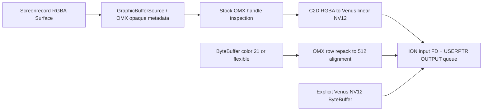

# Stock A9 hardware video encoder: userspace evidence

2026-10-25, agent. Host-only REA and inspection of user-supplied captures; no
adb, fastboot, EDL, USB, phone execution, firmware execution, or image changes.
The matching mainline encoder is still unqualified; this report establishes
stock behavior and comparison targets, not the cause of the mainline SoC reset.

The stock hardware path is **32-bit OMX**, not `c2.qti.avc.encoder`.
For 320×240, stock negotiates eight raw input buffers of **393216 bytes** and
four AVC bitstream buffers of **245760 bytes**, with one V4L2 plane each.
`USERPTR` is a Qualcomm FD-carrying ABI over ION DMA-BUFs. Surface RGBA is
converted by C2D into linear Venus NV12. Ordinary ByteBuffer color 21 is
repacked in place into 512-aligned storage; explicit Venus color skips that
repack. These distinctions matter more than the misleading default log text
“NV12 UBWC”. Successful user captures now corroborate both paths.

## Evidence boundary and reproducibility

The selected package is `$A9_DATA/HLTE556N`. Its
`super_5.img` and `super_2.img` are **raw ext4 filesystem fragments**, despite
the `super_` names; `debugfs -R 'cat /member' IMAGE` reads their vendor and
system members directly. No full super reconstruction, mount, or extraction on
NFS was needed. All extracted files, scripts, inventories and full REA records
are on local ext4 under:

`/home/user/A9-build/mainline/agent-stock-hvenc-userspace-20261025/` (`R` below).

`R/files.json` records member names, sizes and SHA256; `inventory.json` covers
vendor `/etc`, `/etc/init`, `/etc/vintf`, `/lib`, `/lib64`, `/bin/hw`, and system
`/system/etc`, `/system/lib64`, `/system/bin`, `/system/apex` direct listings.
Additional explicitly selected members include the media init script,
`system_properties.xml`, framework recorder and BufferQueue helper. No claim of
absence is made outside these search boundaries.

| Artifact | SHA256 | Meaning |
|---|---|---|
| vendor `/lib/libOmxVenc.so`, 272120 B | `3a3c94eb7fbfa591373f05646c5e264d575af373097c58a2a4aa32eeca5453dc` | ARM/Thumb library used by the packaged service |
| vendor `/lib64/libOmxVenc.so`, 386192 B | `6d7847173f2652a253d5bb0fe4392e693da59d4dc90c8164ac7631e2b007be42` | ARM64 counterpart, matches earlier encoder REA |
| vendor OMX service, 9760 B | `4add10965d0738a499b8b8d004cecd0741a58633d2a6f9db352e89c59ca58363` | ELF32 ARM, even when the application/probe is ARM64 |

Vendor `build.prop:16,20–22` identifies Android 11 / L2037.6.01.01, and
`:8–9` identifies bengal. This identifies the **package userspace**, not an
exact kernel build. The supplied runtime captures are **LOS 23.2 GSI plus stock
vendor and 4.19.157-perf kernel built 2022-12-28**, per
`/home/user/A9-build/stock-hvenc-capture-20261025/FACTS-cap1.md`. They are not
measurements of the complete Android 11 stock framework/camera application.

REA 6.5.0 / Ghidra 12.1.4 ran through isolated local CLI MCP children. The active
chat had no REA connector; configuration was not changed. Full static evidence
is exported in `R/rea*/…evidence.json`, with readable `.c`/`.txt` alongside.
`R/evidence-index.json` and `procedure-locations.json` retain Evidence IDs and
locations. Earlier matching ARM64/gralloc evidence is preserved in `R/prior`.
Decompiled code is recovered pseudocode, not vendor source or an execution trace.
All owned sessions were exported and closed.

Addresses below are **Ghidra analysis addresses**, not ASLR runtime PCs.
ARM64 image bias is `0x100000`; ARM bias is `0x10000`, with Thumb function-bit
normalization. File offsets are separately resolved through ELF PT_LOADs:
**do not subtract one universal image base to obtain file offsets**. The
procedure table at the end supplies checked offsets and canonical Evidence IDs.

## Components, advertised limits and defaults

Vendor VINTF `etc/vintf/manifest.xml:84–96` declares OMX 1.0 `IOmx` and
`IOmxStore/default`. `etc/init/android.hardware.media.omx@1.0-service.rc`
starts `vendor.media.omx` as `mediacodec`, groups camera/drmrpc/mediadrm/audio,
with foreground cpuset and realtime I/O priority 4. No vendor C2 service,
`libcodec2` implementation, `libqcodec2*` or `c2.qti.*` entry appears in the
listed vendor directories/media XMLs. This package therefore supplies **no
evidence for a QTI C2 AVC encoder path to reproduce**.

`OMX.qcom.video.encoder.avc`, `.hevc`, `.hevc.cq`, `.heic`, `.h263sw`, and
`.mpeg4sw` are declared in `media_codecs*.xml`. AVC/HEVC hardware goes through
`libOmxVenc`; the `sw` names must not be counted as Venus hardware codecs.
The filename/registry strings and runtime OMX-VENC tags corroborate the OMX
implementation. HEIC and HEVC CQ are special still-image/CQ configurations;
their limits should not be applied to ordinary AVC recording.

| Declaration | AVC and ordinary HEVC | Other encoder declarations |
|---|---|---|
| `vendor/etc/media_codecs.xml` | 128×128…1920×1088; alignment 2×2; block 16×16; 64…244800 blocks/s; 1…60 Mbit/s; 1…120 fps; 16 instances | HEVC CQ 128×128…512×512, 1…20 fps, quality 0…100/default 80; HEIC 512×512…8192×8192; H263/MPEG4 software ≤864×480 |
| `media_codecs_vendor.xml` | Same dimensions/rate/bitrate/instances; blocks/s max **489600**, performance points 1080p60 and 720p120 | HEIC minimum 480×480; separate HEVC CQ; software codecs |
| `media_codecs_vendor_v1.xml`, `_v2.xml` | blocks/s max **244800**, points 1080p30 / 720p60 / 480p120 | AVC/HEVC ordinary limits otherwise match base |

The frame-rate maximum is a dimension-dependent capability envelope, not a
promise of 1080p120. `media_codecs_performance*.xml` are `update="true"`
measured-rate hints: e.g. AVC 320×240=238–238, 720p=50–50, 1080p=55–65;
HEVC includes a 4K measured-rate row despite the declared 1088 maximum. Such a
row does not independently grant 4K encoding. These encoder declarations require
AllocateBuffer on input/output and Loaded→Idle after allocation.

`system/system/build.prop:129` sets
`media.settings.xml=/vendor/etc/media_profiles_vendor.xml`. That file declares
H264 and HEVC 64 kbit/s…60 Mbit/s, 176×144…1920×1080, 15…30 fps, plus H264 HFR
metadata up to 1080p120. Camera 0/1 profiles include QVGA H264 512 kbit/s/30,
720p 14 Mbit/s/30 and 1080p 20 Mbit/s/30. The alternate `media_profiles.xml`
has H264 max40 Mbit/s and 720p12/1080p17 Mbit/s, while `_scuba.xml` resembles
the vendor profiles. **Profiles are presets, not measured camera capability.**

`vendor/bin/init.qti.media.sh` selects `vendor.media.target.version` from
bengal SoC ID and the VIDC `sku_version`: IDs 441/471/473/474 choose 2 (or 3 for
SKU1); other IDs choose 1 only for SKU1. The RC copies it to
`vendor.sys.media.target.version` after data mount. Effective XML selection and
actual property values must be recorded at runtime; this report preserves the
variants rather than silently choosing their highest limits.

The XML does **not** specify input color defaults. The actual library does:

- `omx_venc::component_init@0x13e8e8` initializes input color
  `0x7fa30c04`, QCOM Venus YUV420PackedSemiPlanar32m; not opaque or flexible.
- The four advertised native input colors, in index order, are
  **`0x7fa30c04`, `0x7fa30c00`, `0x7f000789`, `21`**. Verified ARM64 table at
  Ghidra `0x10c130`, ELF VA/file offset `0xc130`, read by
  `dev_get_supported_color_format@0x144068` / `venc_get_supported_color_format`.
  Flexible `0x7f420888` is accepted through framework normalization; it is not a
  fifth entry in this native table. Captured flexible requests become OMX21.
- Device open initially selects linear fourcc NV12. Unsupported/opaque color
  fallback assigns NV12 but prints “Default color format NV12 UBWC is set”.
  The printed string is **not evidence of Q128/UBWC**.

Stock system `lib64/libcodec2_vndk.so` is the platform Codec2 allocator/store
library, not a vendor V4L2 encoder. REA `GetCodec2PlatformComponentStore`
`@0x1510b0` creates `C2PlatformComponentStore`; `GetCodec2BlockPool@0x15706c`
creates basic linear or graphic pools for IDs0/1 via the platform allocator.
This is a different artifact from the Android16 GSI library analyzed during
mainline work. The stock swcodec APEX lists software `libcodec2_soft_avcenc`,
`…hevcenc`, etc.; existence of `libcodec2_vndk` does not establish `c2.qti.*`.
`debug.stagefright.ccodec=1` in stock system build.prop likewise does not
manufacture a missing QTI C2 provider.

## Device configure → first input QBUF

These are the recovered AVC nonsecure path and measured Surface sequence.
Client configuration changes order/repetition: there is no single universal
sequence for camera, screenrecord, ByteBuffer, HEVC, CQ and every extension.

| Phase | Calls and state | Evidence |
|---|---|---|
| Open | `/dev/video33`, `open` flags2/O_RDWR; subscribe vendor events `0x08001001`, `0x08001005`; QUERYCAP; ENUM_FMT CAPTURE(type9) then OUTPUT(type10) | ARM `venc_open@0x42d40`; ARM64 `@0x14b158`; captured minor33 |
| Initial format | CAPTURE_MPLANE S_FMT H264 (`0x34363248`) or HEVC; OUTPUT_MPLANE S_FMT **NV12 `0x3231564e`**, initial 176×144; initial REQBUFS request2 on both queues, memory2 | Open code. Initial request2 is not final actual count8/4 |
| Client dimensions/format | OMX VideoPortFormat / PortDefinition dispatch to S_FMT, framerate via S_PARM; client AVC parameters/bitrate/color aspects add S_CTRL calls below | ARM `venc_set_param@0x4a454`, ARM64 `@0x153d38`; cap2.logcat |
| Buffer requirements | G_FMT OUTPUT; G_CTRL `0x00980928` MIN_BUFFERS_FOR_OUTPUT; G_FMT again; capture obtains MIN_BUFFERS_FOR_CAPTURE `0x00980927`; keep returned plane count and sizeimage, page-round input allocation; reject minimum counts >64 | `venc_get_buf_req@0x437fc` / `@0x14be98` |
| Allocation | AllocateBuffer / ION allocation and mapping; input8×393216, capture4×245760 at320×240, both **one plane**; input extradata disabled | cap2.logcat:3821–22,4045–4139; helper functions |
| Start | `venc_start` → `venc_reconfig_reqbufs`: REQBUFS OUTPUT count8/memory2, CAPTURE count4/memory2; STREAMON **CAPTURE** | ARM `@0x44190`, `@0x4457c` |
| Prime output | FTB→QBUF CAPTURE buffers0…3, bytesused0, allocation245760, before first input ETB | cap2.logcat:4183–4193; cap3-21.trace:25–34 |
| First Surface frame | Recognize RGBA handle; C2D conversion; set OMX color0x7fa30c04→V4L2 NV12, refresh requirements and color aspects | cap2.logcat:4211–4245; opaque handler and C2D code |
| First input | Dynamic config/extradata handling; native-recorder S_CTRL; dimension G_FMT checks; STREAMON **OUTPUT** before first input QBUF; QBUF OUTPUT with timestamp, FD/offset, length and filled length | ARM `venc_empty_buf@0x44f10`; cap3-21.trace ETB:64, OUTPUT qbuf:66 |

The exact ioctl request numbers differ by ABI. For ARM32, S/G_FMT are
`0xc0cc5605` / `0xc0cc5604`, QBUF `0xc044560f`; ARM64 uses `0xc0d05605` /
`0xc0d05604`, QBUF `0xc058560f`. Shared requests include S_CTRL `0xc008561c`,
G_CTRL `0xc008561b`, REQBUFS `0xc0145608`, STREAMON `0x40045612`.
This matters when interpreting strace or an interposer around the **32-bit**
service. Capturing only syscalls of the ARM64 client misses vendor driver I/O.

### Memory, planes and cache contract

Both queues use **V4L2_MEMORY_USERPTR=2**, not MMAP or DMABUF=4. That does
not mean ordinary malloc is handed to Venus. In `venc_empty_buf` and
`venc_fill_buf`, each `v4l2_plane` supplies userptr, bytesused, allocation length,
data offset, and a DMA-BUF FD in Qualcomm's **`reserved[0]`**, with mapping offset
in **`reserved[1]`**. CAPTURE logs userptr0 while still supplying a valid FD;
input supplies the mapped ION pointer. Do not implement this reserved-field ABI
on an upstream driver expecting standard `m.fd` DMABUF import.

Y and UV occupy one contiguous image allocation/one V4L2 plane. This differs
from treating NV12's two color planes as two V4L2 memory planes. The returned
`num_planes` is authoritative. When it exceeds1, the final V4L2 plane is treated
as extradata (`num_planes-1`), with its own FD, offset, size and filled size;
per-buffer extradata storage is page-rounded and indexed. The stock code checks
limits up to VIDEO_MAX_PLANES8. **The measured ordinary AVC runs have no input
extradata plane**; do not add one to reproduce these runs.

OMX `alloc_map_ion_memory` page-rounds the requested allocation. Nonsecure mask
is `0x02000200`, with flags `requested_flags & 1`; color21 forces cached bit1.
The mask includes alternatives: it does not identify which heap supplied a
particular allocation. Surface/C2D destination and explicit Venus ByteBuffer
input use flags0 in the captures; standard21/flexible input and all AVC output
allocations use flags1. Those are **ION allocation flags**, distinct from OMX
flags (EOF0x10, CODECCONFIG0x80) and V4L2 buffer flags.

The measured OMX QBUF log flags are0. Generic v4l2 trace adds QUEUED and
TIMESTAMP_COPY; its top-level `bytesused=0` is not a reliable multi-planar
filled-length observation. Use OMX's per-plane QBUF line and
`msm_v4l2_vidc_buffer_event_start` instead. No measured userspace cache-bypass
flag is established. Cache clean/invalidate after import belongs to the stock
kernel path and agent's report; allocator cache bit1 alone does not prove
coherency. Successful color21 *and* uncached Venus runs rule out “stock always
requires uncached raw buffers” as a universal claim.

### Color mapping and compiled Venus alignment helpers

| OMX color | V4L2 | Interpretation |
|---|---|---|
| 21, `0x7fa30c04` | `NV12` / `0x3231564e` | linear Venus NV12; color21 additionally requests repacking |
| `0x7fa30c00` | `NV21` / `0x3132564e` | linear interleaved VU |
| `0x7fa30c06` | `Q128` / `0x38323151` | 8-bit NV12 UBWC |
| `0x7fa30c07` | `RGB4` / `0x34424752` | RGBA path |
| `0x7fa30c08` | `QRGB` / `0x42475251` | UBWC RGB |
| `0x7fa30c09` | `Q12A` / `0x41323151` | 10-bit UBWC |
| `0x7fa30c0a` | `QP10` / `0x30315051` | P010 Venus |

The supported mapping switch is broader than the four enumerated OMX colors.
Stock ENUM_FMT also lists **Q512 `0x32313551`**, NV12 512-aligned.
`get_media_colorformat@0x14aae8` maps NV12→helper enum0, Q128→2, Q12A→3,
QP10→9, Q512→10; unsupported inputs return enum2 with an error log. HEIF has a
separate Q515 override outside this AVC sequence.

The package does not ship `msm_media_info.h` as source. Its compiled
`VENUS_BUFFER_SIZE` is recoverable, so the **actual shipped constants** take
precedence over a similarly named header from another Qualcomm release.
Let A(x,n) round x up to n, with positive dimensions:

| Helper enum | Recovered storage alignment |
|---|---|
| 0/1, linear NV12/NV21; 10, NV12_512 | Y/UV stride=A(width,512); Y scanlines=A(height,512); UV scanlines=A(ceil(height/2),256); final allocation A(Y+UV,4096) |
| 2, UBWC NV12 | pixel stride=A(width,128); ordinary Y/UV scanlines align32; metadata Y blocks32×8, UV blocks16×8, metadata strides align64 and scanlines align16, metadata sizes align4096 |
| 3, UBWC TP10 | pixel stride=A(ceil(width/192)×256,256); pixel scanlines align16; Y metadata uses48×4 blocks, UV24×4; metadata stride64/scanline16/page4096 |
| 9, P010 | stride=A(width×2,256); Y scanlines32; UV scanlines16; final page alignment |

Eight-bit UBWC (helper enum2) has an additional low-resolution branch: width/height≤1920 and area<
`0x1fe100` split the height, calculate aligned data/metadata for the half image,
and double the result. The enum2 branch and separate enum3 code are retained in
`VENUS_BUFFER_SIZE` evidence. Do not replace that branch with a generic formula
from another header. `R/rea/VENUS_BUFFER_SIZE-0x14ac04.txt` contains the complete
switch; UV alignment table at ARM64 file `0x1a690` is
`[256,256,32,16,256,256,256,256,16,16,256]`.

For **320×240 linear NV12**, this gives stride512, Y512 lines, UV256 lines,
Y size262144, UV offset262144, UV size131072, total **393216**. The same helper
also returns393216 for176×144, matching the captured initial requirements.
This proves compiled layout rules and matches allocation sizes; it does **not**
by itself measure `v4l2_format.bytesperline` or every firmware plane constraint.
Those struct fields need an ioctl capture. The 393216 capacity cannot be
explained by assuming the firmware consumes RGBA just because a gralloc RGBA
allocation can have a similar size.

`venc_color_align@0x44860` (ARM), `@0x14d2c8` (ARM64), explicitly verifies
capacity against the layout above, moves chroma rows backwards from width×height
to the aligned UV offset, moves luma rows backwards from tight rows to the
512-byte stride, and sets `nFilledLen=nAllocLen`. The normal non-opaque OMX21
proxy invokes it before `venc_empty_buf`. It does not initialize every padding
byte. The probe zeros spare capacity before filling its pattern.

C2D is independently corroborating: `libc2dcolorconvert.so`
`calcStride@0x1032c4` and `calcYSize@0x102b90` use512 alignment for converter
formats9/10, while `calcSize@0x102670` sums Y512 and UV256 storage. Captured
RGBA conversion is converter enum6→10. These converter enums are not OMX,
V4L2, HAL or `msm_media_info` enum numbers.

### Controls, values and order

**Correction to FACTS-cap1.md:** OMX's `%d` control IDs are **decimal**.
For example 10029675=`0x00990a6b`, not `0x10029675`.
10029515=`0x009909cb` is **GOP_SIZE**, so599 is not an H264 level.
10029533=`0x009909dd` is MULTI_SLICE_MODE, not 8×8 transform. Names of standard
controls are checked against the NDK's Linux UAPI header; private controls are
identified from the recovered helper/call context.

The following is cap2 Surface/screenrecord's order through first ETB. L denotes
an explicit captured numeric log; C denotes a recovered write without a
numeric success log. The code supplies the missing writes; an ioctl trace is
still needed to claim a complete *observed* syscall stream or return values.

| Order | ID (hex) | Value | Meaning / basis |
|---|---|---|---|
| 1 | `0x00992077` | 3932160=`60<<16` | Operating rate, cap2:3818 (call log) |
| 2 | `0x00990a6b` | 0 | AVC baseline profile, L3846 |
| 3 | `0x009909cb` | 599 | GOP size, L3847; ByteBuffer cap3 instead9 |
| 4 | `0x00990a65` | 0 | CAVLC entropy, L3850 |
| 5 | `0x00990a6a` | 0 | Loop filter enabled, L3852 |
| 6 | `0x00990a68` | 0 | Loop filter alpha, L3854 |
| 7 | `0x00990a69` | 0 | Loop filter beta, L3856 |
| 8 | `0x009909dd` | 0 | Single-slice mode, L3858 |
| 9 | `0x00990a63` | 0 | 8×8 transform off, C; “Set h264_transform_8x8 mode: 0” L3859 |
| 10 | `0x009909d7` | 1 | Frame RC enable, C at start of `venc_set_ratectrl_cfg` |
| 11 | `0x009909ce` | 0 | VBR mode, L3867 |
| 12 | `0x00992083` | 3 | Bitrate savings, C; “Set bitrate savings 3” L3868; failure nonfatal |
| 13 | `0x009909cf` | 1000000 | Target bitrate, L3871; cap3 instead300000 |
| 14–17 | `0x0099203c/3d/3e/3f` | 5,0,2,2 | Primaries/range/transfer/matrix, L3879–85 |
| 18–21 | same four | 6,0,6,6 | Dataspace update, L3998–4004 |
| 22 | `0x00992077` | 3932160 | Operating-rate repeat, L4015 |
| 23–26 | `0x0099203c/3d/3e/3f` | 5,0,6,6 | Converted-buffer colorspace, L4239–45 |
| 27 | `0x0099207a` | 0 | Native-recorder/implicit B-frame policy, L4248, before OUTPUT STREAMON |

Optional B-frames (`0x009909ca`) are only set through the relevant branch;
measured config B=0 is not evidence of an explicit B_FRAMES=0 write. There is
no logged H264_LEVEL S_CTRL here. `venc_set_level@0x156268` exists, but cannot
be inferred from the GOP log. Session priority prints NonRealTime; the
conditional priority control `0x00992039` is distinct from a mandatory observed
write. Secure-session `0x00992010=1` belongs to the secure branch, not this run.
The ARM and ARM64 rate-control code also demonstrate that logging only lines
containing “Success IOCTL” loses mandatory RC_ENABLE and bitrate-savings writes.

## Surface, camera, gralloc and ION



The packaged framework's `GraphicBufferSource::configure@0x112fa4` calls the
consumer with usage `codec_usage | 0x10000` (**VIDEO_ENCODER**), default format
`0x22` (IMPLEMENTATION_DEFINED), dimensions and dataspace.
`venc_get_consumer_usage` normally contributes0 for eight-bit input, optionally
CPU-read3 or ten-bit `0x40000000` and private compression-related conditions.
Producer usage is combined later: **0x10000 is not the complete measured
screenrecord/camera allocation usage**.

The matching package gralloccore/utils bytes were compared with retained REA.
`GetImplDefinedFormat@0x10f078` under ordinary VIDEO_ENCODER usage selects HAL
`0x102` for IMPLEMENTATION_DEFINED, or Venus `0x7fa30c04` for YCbCr420888.
Private UBWC condition `(usage & 0x2000010000000)!=0` can select
`0x7fa30c06`; optional compression is disabled by CPU-access low-byte bits.
`IsUBwcEnabled@0x10f060` recognizes explicit UBWC formats and also checks
usage/support. Camera/ZSL, HEIF, ten-bit and secure-preview cases have separate
branches. The output is not universally UBWC merely because it feeds an encoder.

`gralloc::Allocator::GetIonHeapInfo@0x10db5c` / `AllocateMem@0x10d9fc` use
ordinary **system ION mask0x02000000** if PROTECTED usage bit0x4000 is absent.
`IonAlloc::AllocBuffer@0x117ad0` adds cached1 according to UseUncached.
Protected ordinary pixel allocation instead has mask0x200 and secure flags
`0x80080000`, with separate special protected-camera/display cases. None of
those secure choices follows from VIDEO_ENCODER usage alone. OMX's own mask
`0x02000200` is a separate allocator path, described above; there is no stock
userspace dma_heap allocation path established for these OMX buffers.

Surface handle format is checked at private_handle+0x2c by
`empty_this_buffer_opaque@0x121030`. It maps color, tests conversion, and can
run C2D or pass through an appropriate handle. **Measured cap2** recognizes
RGBA8888 (HAL1), sets converter6→10, changes device color to0x7fa30c04 and
submits linear NV12. **Measured cap3** avoids Surface/C2D; standard21/flexible
uses CPU memmove repacking, and explicit Venus skips it. “C2D” here is the
Qualcomm 2D color converter, unrelated to Android Codec2's `C2` prefix.

For MediaRecorder, packaged `libmediaplayerservice.so`
`StagefrightRecorder::setupVideoEncoder@0x198ed0` creates the MediaCodecSource
and configures video; `setupCameraSource@0x19a000` creates the camera source and
queries `metaDataStoredInVideoBuffers`. The OMX opaque handler contains both
camera metadata and non-camera handle branches. These establish supported
routes, **not the selected layout, heap or usage of an unmeasured camera app**.
The full consumer/producer usage, selected private_handle format and allocator
exporter must be captured for an actual camera recording. Static Surface
support does not establish that all camera sessions take the RGBA→C2D path.

Kernel-owned internal buffers must not be confused with OMX/gralloc raw input.
The user capture reports scratch/scratch1/scratch2/persist sizes
`0x11f000/0x5e000/0x49000/0x5000`. Persist specifically uses mask0x200/flags5
and a low IOVA, unlike scratch's mask0x02000000/flags1. That is a separate kernel
allocation question for agent; “all stock buffers use the same NS heap” is
not supported by the runtime evidence. No userspace finding justifies moving
an ordinary encode into a protected session/context bank.

## Properties and configuration knobs

Direct Android properties read by the selected ARM64 encoder, with literal
**file offsets**; ARM constructor behavior is corroborated by the captures:

| Property | Offset | Behavior / timing |
|---|---|---|
| `vendor.vidc.debug.level` | `0x16dc0` | OMX constructor, parses with **strtoul base16**; use `0xff` or `ff`, not decimal255 expecting0xff. Error1/high2/low4 log tests and other trace bits are visible in code |
| `vendor.vidc.enc.log.in` | `0xf613` | `atoi`, enable input raw dumps when nonzero; ORed with XML enable, read in venc_dev constructor |
| `vendor.vidc.enc.log.out` | `0x12441` | output bitstream dumps, same construction timing |
| `vendor.vidc.enc.log.extradata` | `0x10a60` | extradata dump logging; does not itself enable an extradata plane |
| `vendor.vidc.cvp.log.in` | `0x12459` | CVP input dump enable, not ordinary raw-format selection |
| `vendor.vidc.log.loc` | `0xd2f2` | dump directory, default `/data/vendor/media` |
| `vendor.vidc.enc.profile.in` | `0xeba0` | ETB input timing/profiling instrumentation, not H264 profile selection |

Properties are read when a new OMX component/device object is constructed;
setting them after creation does not prove the existing instance changed.
Constructor Evidence `ev_7c40a0fd68c77e82d5ece31b83986c4b6d3b48979001478cc5e730a4015c1be3` at Ghidra`0x13e3b8`, ELF VA/file`0x3e3b8`, confirms the base16 parse.
The bounded encoder string scan found no direct `debug.vidc.*` spelling. Do not
recommend a guessed alias. `vendor.media.target.version` and
`vendor.sys.media.target.version` affect platform variants; record their actual
values rather than changing them during a baseline capture.

There is a second, easily confused configuration mechanism:
`libplatformconfig.so` constructor `@0x104038` loads
`/vendor/etc/system_properties.xml`; `getInt32@0x104240` looks up a **literal XML
key and atoi(value)** or its caller default. These underscore names are not
Android setprop names in that code path. `isConfigStoreEnabled@0x104e10`
returns1, but that fact does not turn every XML key into a dotted sysprop.

| Encoder-relevant XML key | File value / caller default when absent | Effect evidenced by callers |
|---|---|---|
| `vidc_enc_log_in`, `vidc_enc_log_out` | 0 / 0 | logging, combined with dotted dump properties |
| `vidc_enc_csc_custom_matrix` | 0 / 0 | custom CSC matrix selection |
| `vidc_enc_linear_color_format` | absent / 0 | consumer usage / linear preference |
| `vidc_enc_bitrate_savings_enable` | absent / **3** | private control0x00992083 |
| `vidc_enc_auto_blur_disable` | absent / 0 | blur/session-priority branch |
| `vidc_disable_hdr` | **3** / 0 | decoder/encoder HDR disable mask |
| `vidc_enc_quality_boost_enable` | **1** / 0 | quality boost branch |
| `vidc_no_vpss` | **1** | separate platform pipeline setting; no blanket inference about every converter |

Key-to-enum table is at libplatformconfig ELF/file0x7050, 16 bytes per entry.
The exact caller index and default are retained in `venc_dev` constructor
`R/rea/venc_dev-0x145080.txt`. These affect configuration; changing logging
properties is not evidence that bitrate savings, linear preference or HDR policy
also changed.

## User captures already obtained

`C=/home/user/A9-build/stock-hvenc-capture-20261025`.
`R/capture-observations.json` retains encoder-only observations with original
line numbers and source hashes, without unrelated logcat messages.

| Run | API input / input ION | First driver ETB | Result supplied by user |
|---|---|---|---|
| cap1/cap2 screenrecord | Opaque Surface RGBA, C2D→linear Venus NV12; input flags0 | alloc393216, filled393216 | cap1 29 frames, 17118-byte MP4; no reset |
| cap3-21 | color21, stride320/slice240, capacity393216; cached1 | alloc393216, filled393216 **after OMX repack** | 30 input /30 output,46624 bytes, EOS,rc0 |
| cap3-0x7f420888 | framework flexible→OMX21, same layout/capacity; cached1 | alloc393216, filled393216 | 30/30, EOS,rc0 |
| cap3-0x7fa30c04 | Venus color, API stride320/slice240, capacity393216; uncached0 | alloc393216, **filled115200** | 30/30,31616 bytes, EOS,rc0 |

cap3-21.logcat:4249 logs client filled115200; :4263 logs driver filled393216.
cap3-0x7fa30c04.logcat:4144/4152 preserves115200 across that boundary.
cap3-21.trace:52–58 primes all four FTBs, :64 submits the first ETB with
alloc/filled0x60000, then :72 returns codec config0x1c bytes. The first-frame
queue/filled-size distinction is therefore corroborated independently of the
probe's final summary. Generic `v4l2_qbuf` top-level bytesused0 must not overwrite
these multi-planar findings.

The explicit Venus test intentionally submits the same tight NV12 pattern with
115200 bytes and skips repacking; completion demonstrates a non-resetting
configuration, **not correct decoded picture geometry for that vendor layout**.
No decoder/pixel comparison was done. Its success also shows that filled length
393216 is not universally required for stock firmware to survive first ETB.

## Exact probe build and run commands

Source: `scripts/mainline/video/codec2/stock-encode.c`. Binary:
`/home/user/A9-build/stock-hvenc-capture-20261025/stock-encode`.
It uses the toolchain already used for the mainline `codec2-encode`, while
targeting API30 for stock Android11 compatibility:

```sh
NDK_BIN=/nix/store/f2n16g0sj97brhnfvj6wavpgv0qix94b-android-sdk-ndk-27.0.12077973/libexec/android-sdk/ndk/27.0.12077973/toolchains/llvm/prebuilt/linux-x86_64/bin
"$NDK_BIN/aarch64-linux-android30-clang" -std=c11 -O2 -Wall -Wextra -Werror \
  scripts/mainline/video/codec2/stock-encode.c -lmediandk -llog \
  -o /home/user/A9-build/stock-hvenc-capture-20261025/stock-encode
```

After the user stages it as `/data/local/tmp/stock-encode` and chmod755, these
are **phone-shell commands for the user**, not commands executed by this worker:

```sh
/data/local/tmp/stock-encode
/data/local/tmp/stock-encode OMX.qcom.video.encoder.avc 21
/data/local/tmp/stock-encode OMX.qcom.video.encoder.avc 0x7f420888
/data/local/tmp/stock-encode OMX.qcom.video.encoder.avc 0x7fa30c04
# Optional exact-name availability/HEVC comparisons:
/data/local/tmp/stock-encode c2.qti.avc.encoder 21
/data/local/tmp/stock-encode OMX.qcom.video.encoder.hevc 21
```

No arguments defaults to OMX AVC/color21. Other codec names are passed through
verbatim; names containing `hevc` select HEVC MIME/codec=2. Invalid color text
or excess arguments returns2. Every normal run sends30 frames at10fps,
300kbit/s, one-second I-frame interval, tight115200-byte NV12 with zeroed spare
capacity, then EOS. It retains `ENCODE_STAGE`, `ENCODE_IO`, terminal `ENCODE`
stdout/logcat lines and adds `ENCODE_CONFIG`, `ENCODE_INPUT_FORMAT` after
configure/start/first buffer, and `ENCODE_INPUT_BUFFER` capacity/queued bytes.
Absent stride/slice keys print-1. Exit0 requires30 inputs, nonempty output and
EOS; actual displayed picture quality remains a separate test.

Host build passed `-Werror`; ELF is AArch64 with system libmediandk/liblog/
libdl/libc dependencies. `R/probe-build.json` and `stock-encode-elf.txt` retain
build/ABI evidence. Binary SHA256:
`14d6c2014e42903058f975226838cf38487dd101a90313c8ebc07006a27eeb21`.
The three user-run cap3 outputs above validate actual execution of this build.

## Remaining rooted-stock capture checklist

The captures close many questions; the following are still needed to make the
comparison exhaustive. Run capture acquisition only through the existing phone
owner (the user). Preserve exact vendor/library hashes and complete command,
resolution/framerate/bitrate/profile/color/client type with each session.

1. **Exact ABI and all ioctls.** Record OMX service executable, `/proc/PID/maps`,
   selected `/dev/video*`, and a decoded syscall/interposer trace of the
   **service**, not just screenrecord/probe. Capture every QUERYCAP, ENUM_FMT,
   S/G_FMT, S_PARM, S/G_CTRL/S_EXT_CTRLS, REQBUFS, PREPARE_BUF if any, STREAMON,
   QBUF, DQBUF, STREAMOFF and encoder STOP, with return values. Preserve full
   multi-planar structs including reserved fields. This resolves unlogged
   controls, actual stride/height/sizeimage fields and precise interleaving.
2. **Per-buffer ownership.** Record ION requested mask/flags and actual selected
   heap/exporter, FD inode/size/fdinfo, userptr, length, filled length, data
   offset, cache synchronization and mapping direction. Capture full gralloc
   usage64 bits, private_handle format/stride/size for Surface and camera.
3. **Both framework origins.** Repeat a real camera/MediaRecorder Surface
   recording, recording selected Camera HAL format and whether C2D is used.
   The current screenrecord and ByteBuffer results do not settle that path.
   Run native HEVC too; AVC success does not establish HEVC control parity.
4. **Firmware submission boundary.** Correlate four FTBs→OUTPUT STREAMON→first
   filled ETB→SPS/PPS→first frame→EOS. Keep msm_vidc buffer, state, internal
   allocation, clocks and firmware response events. Kernel/HFI commands,
   constraints and persist/scratch allocation comparison belong to agent.
5. **Effective configuration.** Record `vendor.media.target.version`,
   `vendor.sys.media.target.version`, `debug.stagefright.ccodec`, the properties
   above, effective XML filenames and parsed encoder capabilities. Avoid
   treating capability XML limits as the actual configuration.

### Logging endpoints that actually exist

This stock capture kernel has **CONFIG_DEBUG_FS disabled**: cap1 reports
“Failed to create debugfs for msm_vidc”. Companion kernel REA
`msm_vidc_debugfs_init_drv@0xffffff8008e25438` is a return0 stub (retained under
`/home/user/A9-build/mainline/stock-hvenc-kernel-20261025/capture-knobs-rea`).
Consequently **`/sys/kernel/debug/msm_vidc/*`, debug_level and fw_debug_level
there are unavailable on this kernel**. Mounting debugfs or setting a guessed
module parameter does not create that interface. On a different stock build
that actually has it, save a recursive names/current-values inventory before
choosing knobs; do not assume another release's filenames or bitmasks.

Tracefs **does** work at `/sys/kernel/tracing`, independently of DEBUG_FS.
The supplied captures enabled `events/msm_vidc_events/*` and `events/v4l2/*`;
`videobuf2` is another useful existing group when present. Useful measured
names are `msm_v4l2_vidc_buffer_event_start/end`, VIDC allocation/map/state/clock
records, and `v4l2_qbuf/dqbuf`. Save each enabled event's `format` file and
`available_events`; a group name alone does not establish its available fields.
Function tracing, kprobes and dynamic-debug are not available in the supplied
kernel config, so do not plan function_graph/kprobe/dynamic_debug captures.
Venus firmware `VFW_E` lines are already forwarded through msm_vidc printk;
retain dmesg alongside tracefs and logcat.

Minimal commands matching the user's successful capture (root phone shell;
save/restore current tracing and property settings around the session):

```sh
setprop vendor.vidc.debug.level 0xff
# Optional raw dumps, create a directory writable by the mediacodec service:
setprop vendor.vidc.enc.log.in 1
setprop vendor.vidc.enc.log.out 1
setprop vendor.vidc.log.loc /data/vendor/media/venclog
T=/sys/kernel/tracing
echo 0 > "$T/tracing_on"
echo 16384 > "$T/buffer_size_kb"
echo > "$T/trace"
echo 1 > "$T/events/msm_vidc_events/enable"
echo 1 > "$T/events/v4l2/enable"
# Enable videobuf2 only if its enable file exists.
echo 1 > "$T/tracing_on"
screenrecord --size 320x240 --bit-rate 1000000 --time-limit 3 /data/local/tmp/stock320.mp4
# Or execute one stock-encode command above, with its stdout saved.
echo 0 > "$T/tracing_on"
cat "$T/trace" > /data/local/tmp/stock320.trace
logcat -d -v threadtime > /data/local/tmp/stock320.logcat
dmesg > /data/local/tmp/stock320.dmesg
```

Raw dumping is optional and changes workload; a baseline plus a diagnostic run
can distinguish that effect. Enabling the debug property before a new codec
object is sufficient for the measured runs; no service restart is prescribed.
For an available strace, an owner can attach with
`strace -ff -ttt -v -s 128 -e trace=ioctl,openat,mmap,munmap -p PID -o PREFIX`
before starting the codec. Its V4L2 decoder may omit Qualcomm reserved fields;
if so, the missing FD/offset/plane fields require a matching 32-bit ioctl
interposer rather than interpretation of a truncated rendering.

## What this resolves for mainline

Match the negotiated storage size, plane count, output-first priming, rate /
profile / colorspace choices, and per-buffer allocation/cache contract before
claiming parity. Distinguish MediaCodec-visible stride320/slice240 from actual
hardware storage. Do not infer UBWC from a log string, a Surface origin, or an
RGBA-sized allocation. Do not copy downstream USERPTR+reserved-FD semantics into
upstream DMABUF ABI. Do not infer an H264 level from GOP size599.

The measured stock path survives both full393216 and short115200 filled ETBs,
and both cached and uncached input allocations. That narrows comparisons but
does **not** isolate the reset cause. Exact S_FMT/firmware plane constraints,
internal persist/scratch placement and a real camera/HEVC session remain open.
“All userspace facts established” would overstate the current evidence.

## Procedure evidence and checked locations

Each row links the complete REA record on local disk. The file offset is in
that record's exact hashed ELF; Ghidra addresses are analysis-time addresses.

| Library / procedure | Ghidra address | File offset | REA Evidence ID |
|---|---|---|---|
| `vendor/lib/libOmxVenc.so` / venc_open | `0x42d40` | `0x31d40` | [ev_c3e16c0b5859064b04262790f8ff9ef6dbde3fcba5f0868d2a1793721d8b59ee](/home/user/A9-build/mainline/agent-stock-hvenc-userspace-20261025/rea-arm/venc_open-0x42d40.json) |
| `vendor/lib/libOmxVenc.so` / venc_set_color_format | `0x4193c` | `0x3093c` | [ev_c2a667ea1dd48fbf2140b861b041573bd655b17c928f6f2437f8beb3cac19815](/home/user/A9-build/mainline/agent-stock-hvenc-userspace-20261025/rea-arm/venc_set_color_format-0x4193c.json) |
| `vendor/lib/libOmxVenc.so` / venc_get_buf_req | `0x437fc` | `0x327fc` | [ev_6075c69ba4d41d81808fa312ad0ca7fa8bde3f6b2ca1113e629e3138ffc1e43b](/home/user/A9-build/mainline/agent-stock-hvenc-userspace-20261025/rea-arm/venc_get_buf_req-0x437fc.json) |
| `vendor/lib/libOmxVenc.so` / venc_start | `0x44190` | `0x33190` | [ev_7c90bac818a211ea0996c8a6832a321424cb4e93889ee5e5421b7c1e9f5e4fa8](/home/user/A9-build/mainline/agent-stock-hvenc-userspace-20261025/rea-arm/venc_start-0x44190.json) |
| `vendor/lib/libOmxVenc.so` / venc_reconfig_reqbufs | `0x4457c` | `0x3357c` | [ev_22fba4e0883c95616756ac68bc3d58905a07c67d731602c9518236794393a392](/home/user/A9-build/mainline/agent-stock-hvenc-userspace-20261025/rea-arm/venc_reconfig_reqbufs-0x4457c.json) |
| `vendor/lib/libOmxVenc.so` / venc_color_align | `0x44860` | `0x33860` | [ev_4a90eb46d9ce8f7f628f5c2c6000bf33b36ac5d2f89de7de17fc52a117f8ce96](/home/user/A9-build/mainline/agent-stock-hvenc-userspace-20261025/rea-arm/venc_color_align-0x44860.json) |
| `vendor/lib/libOmxVenc.so` / VENUS_BUFFER_SIZE | `0x44988` | `0x33988` | [ev_3f6fe6092029a872c6a9dfa9a098af2a6f4a4c058b4c351b6107d9cfc898779c](/home/user/A9-build/mainline/agent-stock-hvenc-userspace-20261025/rea-arm/VENUS_BUFFER_SIZE-0x44988.json) |
| `vendor/lib/libOmxVenc.so` / venc_empty_buf | `0x44f10` | `0x33f10` | [ev_4f35c98d2c1d984db5f14e94fe58e74f52f9c058c84b673534f6969cc2297277](/home/user/A9-build/mainline/agent-stock-hvenc-userspace-20261025/rea-arm/venc_empty_buf-0x44f10.json) |
| `vendor/lib/libOmxVenc.so` / venc_fill_buf | `0x47684` | `0x36684` | [ev_cf4000fd4bee35f25559d50bbe6c8058c5ea070e8c30f727cb8f17a10574b59d](/home/user/A9-build/mainline/agent-stock-hvenc-userspace-20261025/rea-arm/venc_fill_buf-0x47684.json) |
| `vendor/lib/libOmxVenc.so` / venc_set_param | `0x4a454` | `0x39454` | [ev_c09083408ec28cedf98fe2d4ac7f03a4dd93b03a25f33e6b0519e62ba10144c4](/home/user/A9-build/mainline/agent-stock-hvenc-userspace-20261025/rea-arm/venc_set_param-0x4a454.json) |
| `vendor/lib/libOmxVenc.so` / alloc_map_ion_memory | `0x2ffa0` | `0x1efa0` | [ev_378a36cb5fd96777c8147d6ca9881b3a01b07b9c657234eafc21c4381eddbcd1](/home/user/A9-build/mainline/agent-stock-hvenc-userspace-20261025/rea-arm/alloc_map_ion_memory-0x2ffa0.json) |
| `vendor/lib/libOmxVenc.so` / venc_set_ratectrl_cfg | `0x4b7b8` | `0x3a7b8` | [ev_4bbefb32ff784af8327bb3917f2c674dce1110c2a545d1355c5e135547df5613](/home/user/A9-build/mainline/agent-stock-hvenc-userspace-20261025/rea-arm/venc_set_ratectrl_cfg-0x4b7b8.json) |
| `vendor/lib/libOmxVenc.so` / venc_set_target_bitrate | `0x47c18` | `0x36c18` | [ev_4c5839a9941c3478691957dc699a36078d15aefd084d906453cf071b5d75f50f](/home/user/A9-build/mainline/agent-stock-hvenc-userspace-20261025/rea-arm/venc_set_target_bitrate-0x47c18.json) |
| `vendor/lib/libOmxVenc.so` / venc_get_consumer_usage | `0x496bc` | `0x386bc` | [ev_dff8f4612a1dd288e7d642f757566a40e2c9ab430676e5d3fada7b221ba63dbc](/home/user/A9-build/mainline/agent-stock-hvenc-userspace-20261025/rea-arm/venc_get_consumer_usage-0x496bc.json) |
| `vendor/lib64/libOmxVenc.so` / component_init | `0x13e8e8` | `0x3e8e8` | [ev_97a786b7d50870fb1822f7d4624a6a2938a8f4b6d43a5a39e3fa792a31254852](/home/user/A9-build/mainline/agent-stock-hvenc-userspace-20261025/rea/component_init-0x13e8e8.json) |
| `vendor/lib64/libOmxVenc.so` / venc_set_param | `0x153d38` | `0x53d38` | [ev_cdadc7386e7fa934e86544ad11d0467dd7e54d13ababbbaca9b5f4448c35fbad](/home/user/A9-build/mainline/agent-stock-hvenc-userspace-20261025/rea/venc_set_param-0x153d38.json) |
| `vendor/lib64/libOmxVenc.so` / VENUS_BUFFER_SIZE | `0x14ac04` | `0x4ac04` | [ev_ec14894ababacfbe210d186a491d1c423f8d4e06e974e04ea9f061bf9eba818b](/home/user/A9-build/mainline/agent-stock-hvenc-userspace-20261025/rea/VENUS_BUFFER_SIZE-0x14ac04.json) |
| `vendor/lib64/libOmxVenc.so` / venc_get_supported_color_format | `0x149478` | `0x49478` | [ev_bdb993eea7ac46bbaa4f7edcf2b41165eccc9c14bc72a11d6f62521ad4523232](/home/user/A9-build/mainline/agent-stock-hvenc-userspace-20261025/rea/venc_get_supported_color_format-0x149478.json) |
| `system/system/lib64/libcodec2_vndk.so` / vndk | `0x1510b0` | `0x510b0` | [ev_710aeee50c46b83888b3efa5fa1c9b5934268514bfe1512dd98194c66b794ac8](/home/user/A9-build/mainline/agent-stock-hvenc-userspace-20261025/rea/vndk-0x1510b0.json) |
| `system/system/lib64/libcodec2_vndk.so` / vndk | `0x15706c` | `0x5706c` | [ev_239a8f26a9a1e7df2d611aae896fe85e137c12b307878b86e51d50f322a4a9e2](/home/user/A9-build/mainline/agent-stock-hvenc-userspace-20261025/rea/vndk-0x15706c.json) |
| `vendor/lib64/libOmxVenc.so` / omx | `0x121ac4` | `0x21ac4` | [ev_c5220efe1deb24798d2f076f86b9443834ee6f3debcf2ebbb6b4ff36aa87d04e](/home/user/A9-build/mainline/agent-stock-hvenc-userspace-20261025/rea2/omx-0x121ac4.json) |
| `vendor/lib64/libOmxVenc.so` / omx | `0x14aae8` | `0x4aae8` | [ev_4aab4149dc5eb2c18d345f812e5391821fa4b7dfb8195380baa8d8e0cdddd258](/home/user/A9-build/mainline/agent-stock-hvenc-userspace-20261025/rea2/omx-0x14aae8.json) |
| `vendor/lib64/libc2dcolorconvert.so` / c2d | `0x102670` | `0x2670` | [ev_55e3f7176c9fa7c7d054f18563e5fe1ab4e9179405afa1bb9ad3d1ab690c725d](/home/user/A9-build/mainline/agent-stock-hvenc-userspace-20261025/rea2/c2d-0x102670.json) |
| `vendor/lib64/libc2dcolorconvert.so` / c2d | `0x102b90` | `0x2b90` | [ev_1ebff5df8aa87edb6e7d183ddfd0deb1674214911214ac7bb6b74ede3c06e04c](/home/user/A9-build/mainline/agent-stock-hvenc-userspace-20261025/rea2/c2d-0x102b90.json) |
| `vendor/lib64/libc2dcolorconvert.so` / c2d | `0x1032c4` | `0x32c4` | [ev_bd519a088ef7966057170970911f5553070d317e20eac0d152b4faa7f7644d79](/home/user/A9-build/mainline/agent-stock-hvenc-userspace-20261025/rea2/c2d-0x1032c4.json) |
| `system/system/lib64/libstagefright_bufferqueue_helper.so` / gbs | `0x112fa4` | `0x12fa4` | [ev_030fcd1d1c73a4d9698361ea949d1a2aaac721e8dd51a6999794bb88817ed750](/home/user/A9-build/mainline/agent-stock-hvenc-userspace-20261025/rea3/gbs-0x112fa4.json) |
| `system/system/lib64/libmediaplayerservice.so` / recorder | `0x198ed0` | `0x98ed0` | [ev_8f352652b7dab7fbd229bebfd263c20236c0eb1acb419b479f185bfb36c62678](/home/user/A9-build/mainline/agent-stock-hvenc-userspace-20261025/rea3/recorder-0x198ed0.json) |
| `system/system/lib64/libmediaplayerservice.so` / recorder | `0x19a000` | `0x9a000` | [ev_faefc62b2e9304f42896678e028e506c8bec74039c40e90f719d8f7e405327a9](/home/user/A9-build/mainline/agent-stock-hvenc-userspace-20261025/rea3/recorder-0x19a000.json) |
| `vendor/lib64/libplatformconfig.so` / platform | `0x104240` | `0x4240` | [ev_97f5aac782b5ac8fc1f473c2f269fe85668d367bb1883fd47945f126791ed046](/home/user/A9-build/mainline/agent-stock-hvenc-userspace-20261025/rea3/platform-0x104240.json) |
| `vendor/lib64/libOmxVenc.so` / omx-color-align | `0x14d2c8` | `0x4d2c8` | [ev_6985b7fb34b70461a5ef24ad90069515d0f12eb0634c7008c57fdd243ac56268](/home/user/A9-build/mainline/agent-stock-hvenc-userspace-20261025/rea4/omx-color-align.json) |


Gralloc prior REA IDs: `ev_bf60821809b9a8ba672a867b202778ed0272d5f69bcf975a335a6074d66723de`
(heap), `ev_20930abc33e68e212745fa41a80faf7907a2ab9f0b252b1fb9a7bac1c5c9adda`
(ION allocation), `ev_9a7422410d3641c3df0e3bc03c703bc57db12010e14ce39f2c73eac599090c09`
(format), `ev_0a078bd025f3a38cd63fd20e6dd418f6439797ef5ec84aa495898e32422e167b`
(UBWC). Canonical copies and artifact hashes are in `R/prior`; these are static
code observations, not full camera-allocation runtime measurements.
