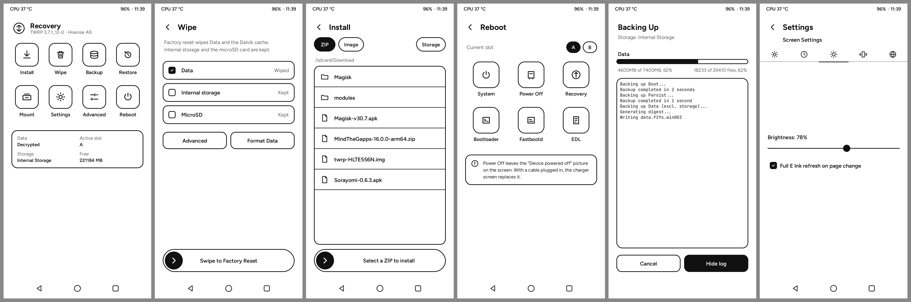

# TWRP "Ink" theme and page-change E Ink refresh

**Status (2026-10-15): ON THE PHONE, USER-CHECKED.** Build **38670003107** (device tree
`ink-theme` `89c77f9`) is on both recovery slots (§11); rollback = build 38662050346. Sections 1-9 describe
the first Ink build, 38640734386 (2026-10-14), and stay valid except where §10 and §11 say otherwise.

Labels: **measured** = read from a file, binary or build output with the tool named; **inferred** =
deduced, not checked on the device.

Preview (rendered offline by `theme/preview.py` from the generated XML, mock data):


## 1. Branches, commits, image

| Repo (GitHub, public) | Branch | Commit | Change |
|---|---|---|---|
| `dmayala/android_device_hisense_HLTE556N` | `ink-theme` (from `eink-ux` `cd79b04`) | `37ab7ac` (built), `4658002` (preview tool only, not in the image) | `design/` (approved mockups), `theme/` (generator, preview, fonts + OFL), `recovery/root/twres/` (generated theme), `BoardConfig.mk` (`TW_HAS_EDL_MODE`, theme comment), README |
| `dmayala/android_bootable_recovery` | `ink-theme` (from `eink-ux` `0540ac3c`) | `b9a4c18b` | `gui/gui.cpp`, `minuitwrp/graphics_hmct_epd.cpp`, `minuitwrp/include/minuitwrp/minui.h` |
| `dmayala/platform_manifest_twrp_aosp` | `ink-theme` (from `eink-ux` `2840b84`) | `ccf0402` | `bootable/recovery` revision `eink-ux` -> `ink-theme` |

`eink-ux`, `android-12.1` and `twrp-12.1` are unchanged, so builds 38624343750 and 31434216263 stay
reproducible.

Build: `dmayala/Action-TWRP-Builder`, "Recovery Build", run **38640734386**, the inputs of 38624343750 with
both branches set to `ink-theme`:

```bash
gh workflow run "Recovery Build" -R dmayala/Action-TWRP-Builder \
  -f MANIFEST_URL=https://github.com/dmayala/platform_manifest_twrp_aosp -f MANIFEST_BRANCH=ink-theme \
  -f DEVICE_TREE_URL=https://github.com/dmayala/android_device_hisense_HLTE556N -f DEVICE_TREE_BRANCH=ink-theme \
  -f DEVICE_PATH=device/hisense/HLTE556N -f DEVICE_NAME=HLTE556N -f MAKEFILE_NAME=twrp_HLTE556N -f BUILD_TARGET=recovery
```

Image: `$A9_DATA/recovery/twrp-HLTE556N-38640734386.img`, sha256 `6af52e42591ed3cfb6cb8eb9580082aae9b9bb623979bd563a63d5bcaee3b8b9` (also in the `.sha256` next to it).

## 2. How the theme gets into the image (measured, source)

- `TW_CUSTOM_THEME` cannot carry a theme. `gui/libguitwrp_defaults.go` `copyCustomTheme()` copies exactly
  one file (`path.Base` of the setting) into `twres/`, and it runs after `copyThemeResources()` has done the
  `{themeversion}` substitution. Images, fonts and `portrait.xml` would stay stock. (The device tree's
  earlier on-device md5 test said the same.)
- What works instead: `TW_THEME := portrait_hdpi` stays. Soong installs the complete stock theme into
  `out/.../recovery/root/twres/` at analysis time. Then the ramdisk rule in `build/make/core/Makefile`
  (TeamWin `android_build` android-12.1, `$(INTERNAL_RECOVERY_RAMDISK_FILES_TIMESTAMP)`) runs
  `cp -rf <device>/recovery/root $(TARGET_RECOVERY_OUT)/`, so the device tree's `recovery/root/twres/`
  replaces the stock files with the same names. This is the same route that already ships
  `libion.so`, `init.recovery.qcom.rc` and the power-off PNG.
- `ui.xml` declares `<resolution width="824" height="1648">`, so TWRP does not scale the theme (stock
  is 1080x1920, scaled non-uniformly 0.763 x 0.858 on this panel before). `<themeversion>6</themeversion>`
  = `TW_THEME_VERSION` in `variables.h`.
- Stock files that are not replaced stay in `twres/` unused (for example `images/indeterminate*.png`).

## 3. What changed

### 3.1 Theme (device tree)

`theme/gen_theme.py` generates everything in `recovery/root/twres/` (`ui.xml`, `portrait.xml`,
`splash.xml`, 79 PNGs, fonts). Input: TWRP's stock `gui/theme/common/portrait.xml` (android-12.1,
byte-identical to TeamWin upstream, checked with `cmp`). Re-run it rather than editing the output:

```bash
cd device_hisense_HLTE556N
nix-shell -p python3Packages.pillow python3Packages.cairosvg --run \
  'python3 -P theme/gen_theme.py --stock <bootable/recovery>/gui/theme/common/portrait.xml'
nix-shell -p python3Packages.pillow --run 'python3 -P theme/preview.py /tmp/prev main2 wipe install reboot backup_run,tw_busy=1'
```

- **Palette:** background `#FFFFFF`, everything else `#111111`, `#5C5C5C` only for secondary text
  (`text_muted_color`). The stock accent band, red/green status colours, dark key backgrounds, black nav
  bars and semi-transparent dimming are gone. Overlays (storage/language dialogs, lock) hide the page
  behind with white instead of dimming it, and the dialog box gets an outline.
- **Shapes:** outlined rounded rectangles with a 4 px stroke (2 CSS px), radii from the mockups x2;
  line icons from the mockups' SVG paths; selected or primary elements solid black with white text.
- **Fonts:** Figtree Regular/SemiBold/Bold and JetBrains Mono Regular, static instances made with
  `fonttools varLib.instancer` from Google Fonts' `ofl/figtree/Figtree[wght].ttf` and
  `ofl/jetbrainsmono/JetBrainsMono[wght].ttf` (sha256 `26ad3db9…`, `48715a42…`). Both OFL 1.1 with no
  Reserved Font Name; licences in `theme/fonts/OFL-*.txt` and shipped in `twres/fonts/`. TWRP font
  `size` = em px x 0.96 (`FT_Set_Char_Size(size*16, 300 dpi)` in `minuitwrp/truetype.cpp`).
- **Designed pages** (layout to the mockups, coordinates = mockup x 2): `main2` (Home), `wipe`,
  `install`, `reboot`, `backup_run`.
- **All other pages** are the stock pages, restyled through the 824x1648 variable set (54 px rows from
  y 240, nav bar 112 px at y 1536), the styles and the images. Header: a back chevron (key `back`)
  replaces the stock logo/home button; nav bar = outline back triangle, home circle, console square.
- **Touch targets:** tiles 172x184 and 234x206, nav and header buttons 88x88, list rows 88 px (112 in the
  file list), buttons 96-162 px tall, keyboard keys 82x124 (terminal row 88). Everything >= 88 px
  except the slot chips (80x64, as drawn in the design).
- **Keyboard:** white keys on ink with 2 px margins (an outlined grid), long-press hints in grey.
- **No press highlight on buttons.** On E Ink a highlight is one more panel update right before the page
  change the press causes anyway. List rows and keyboard keys keep a highlight, as a solid ink
  inversion (white text on black), not a grey.
- **No indeterminate progress animation** on action pages: the 24 fps stripes made the TCON update
  continuously. The bar, the progress text and the console still show progress.
- **Settings > Screen:** checkbox "Full E Ink refresh on page change" (`tw_eink_page_refresh`,
  persisted in TWRP's settings file).
- **Reboot > EDL:** `TW_HAS_EDL_MODE := true` (consumed by `bootable/recovery/Android.mk`, `LOCAL_CFLAGS`
  of the `recovery` module, so `data.cpp` sets `tw_edl_mode=1`; it needs no Soong export). TWRP does
  `sys.powerctl=reboot,edl`, the same as `adb reboot edl`, which works from TWRP on this phone
  (a9-recover skill R5). The tile goes through a swipe confirmation that says how to leave EDL.

### 3.2 Page-change full refresh (recovery fork)

- `gui_changePage()` and `gui_changeOverlay()` (the only ways pages change; actions, ORS, adb backup
  all go through them, checked with grep) mark the page dirty.
- In `runPages()`, right before the flip of the next fully rendered frame, `gr_epd_force_next_flip()`
  arms the backend's one-shot: `hmct_flip()` calls `ForceClearGhosting(1)` before `drawImage()`. So the
  **first frame of the new page is itself drawn with the full GC16 table**. Both tables are 38 frames
  (twrp-eink-ux §2, §4), so a page change costs one update, as before; it just flashes and leaves no
  ghost.
- Debounce: at most one forced refresh per 1000 ms. A page change inside that window is not forced;
  instead one trailing `gr_epd_full_refresh()` runs once navigation has been quiet for 400 ms (and 1 s
  after the last forced one). Rapid back-back-back gives one flash at the start and one at the end, never
  a queue: the force is a flag, not a queued image, and `drawImage` during an update overwrites the
  single lost-image slot (twrp-eink-ux §5).
- Not triggered by key presses, keyboard typing, scrolling, progress or console output (none of them
  change the page). The E Ink key path is unchanged.
- Off: Settings > Screen checkbox, or `adb shell twrp set tw_eink_page_refresh 0` (back on with `1`).
  A theme without the variable behaves as on. No effect on other display backends
  (`gr_epd_active()` is false there).
- Log lines: `E Ink: full refresh on page change` and `E Ink: full refresh after navigation settled`
  (the latter followed by the backend's own `hmct_epd: full refresh`).

## 4. Design items not reproduced, and why

| Design | In the theme | Why |
|---|---|---|
| Home card "System: LineageOS 23.2" | Omitted; the card shows Data, Active slot, Storage, Free | TWRP keeps no variable for the installed ROM (`ro.build.display.id` is read only to name backups) |
| Home card "Decrypted · 216 GB free" | "Data: Decrypted / Encrypted / Not encrypted" and "Free: N MB" for the current storage | TWRP XML has no arithmetic (MB only), and free space belongs to the selected storage, which may be the microSD |
| Status bar battery glyph | Text only: `96% · 11:39` | No battery-level images in TWRP; a fixed glyph would lie. `tw_battery` carries a trailing space or `+` (charging), so there is a double space or `96%+` |
| Wipe rows Data / Cache / Internal / MicroSD with ticks | Data (ticked, "Wiped"), Internal storage and MicroSD (unticked, "Kept"); no Cache row | The A9 has no `/cache` (fstab). The rows are a read-only summary of what factory reset does, with a muted Wiped/Kept label; choosing partitions is Advanced Wipe (button below) |
| Wipe text "wipes Data and Cache" | "wipes Data and the Dalvik cache" | Same reason |
| Install chips Internal / MicroSD / Image | ZIP / Image (mode, solid = active) and Storage (opens TWRP's storage list) | Storage selection must go through TWRP's storage list (`tw_storage_path`), which also covers USB OTG; the microSD mount path was not measured |
| Install list row meta ("Folder", "12 MB") | One line per row | The file selector draws a single text per row |
| Install sort | No Name/Date/Size row on this page | Not in the design; sorting stays on the file manager / restore pages and is persisted |
| Install "Select a ZIP to install" slider | Static pill (same drawing), not a slider | Selecting a file opens the confirm page, which has the real swipe |
| Swipe text left of the knob | Centred on the pill | `slider.cpp` always centres the label |
| Reboot "Current slot" chips | As drawn; tapping the other slot asks for a swipe | Stock switches the slot on a tap; on a daily phone that is too easy to hit |
| Reboot > EDL | Present (`TW_HAS_EDL_MODE`), with a swipe confirmation | Real flag; confirmation because EDL waits for a host tool and only a long Power press leaves it |
| Backup "62%" right of "Data", "about 3 min left" | Percentages are inside `%tw_size_progress%` / `%tw_file_progress%` under the bar; no ETA | No separate percent variable and no ETA in TWRP |
| Backup subtitle "Boot, Data, Persist to MicroSD" | "Storage: <storage>" | `tw_backup_list` is a list of mount points, not display names |
| Backup "Hide log" | Works: Hide log / Show log toggle the console (`tw_ink_hide_log`) | A conditional button change makes TWRP re-render the whole page (`GUIButton::Update`), so no page reload (which would restart the backup) is needed |
| Backup title at x 52 | As drawn; during the backup the header chevron is hidden (`tw_busy`) | |
| Non-Latin languages | Figtree has no Cyrillic/CJK glyphs | Languages that ship their own font resources keep them; others will miss glyphs |

## 5. Measured vs inferred

**Measured offline:** the source facts in §2 and §3 (file/function named each time); the generated XML
is well-formed and every referenced image, font and theme variable exists (script check); the preview
renders of all designed pages and 16 stock pages (settings, settings_screen, advanced, mount, backup,
backup_options, restore, filemanagerlist, decrypt, terminalcommand, confirm_action, action_page,
advancedwipe, formatdata, action_complete, select_storage overlay); the image checks in §6.

**Inferred, not checked on the device:** that TWRP loads the theme without a fallback to stock (watch the
log for `theme version` or resource errors); the exact text baselines (the preview reimplements
`truetype.cpp`'s box but not its rendering); that `ForceClearGhosting(1)` before `drawImage()` of the
first frame gives a single full update (follows from the disassembly in twrp-eink-ux §2, the same
mechanism the E Ink key already uses on the phone); that `reboot,edl` from the GUI reaches 9008 (same
property as `adb reboot edl`); that the preview's list row heights equal TWRP's.

## 6. Offline verification of the image (measured, 2026-10-14)

Image `twrp-HLTE556N-38640734386.img` (100,663,296 B, release asset `recovery.img` of run 38640734386;
build log shows `Manifest Branch: ink-theme`, `Device Tree Branch: ink-theme`), compared with build
38624343750 (the TWRP on the phone) using AOSP `tools/unpack_bootimg.py`, `cmp` and per-file sha256 of
the unpacked ramdisks:

| Check | Result |
|---|---|
| Boot header version / page size | 2 / 4096 |
| kernel / ramdisk load address | `0x8000` / `0x1000000` |
| Kernel | byte-identical to `prebuilt/kernel` (15,047,394 B) |
| `recovery_dtbo` | **88,722 B**, byte-identical to `prebuilt/dtbo.img` |
| DTB | 327,956 B, byte-identical to `prebuilt/dtb.img` |
| `scripts/abl-check.sh  recovery` (the phone's ABL in Unicorn; not a boot proof) | **PASS** (header, dtbo, dtb overlay: model "Qualcomm Technologies, Inc. Bengal QRD") |

Ramdisk, new versus 38624343750, file by file:

- `twres/`: 41 files added (35 new images, 4 fonts, 2 OFL texts) and 47 changed (`ui.xml`,
  `portrait.xml`, `splash.xml`, 44 images). All 88 files are byte-identical to
  `recovery/root/twres/` in the device tree (cmp loop), so the overlay landed as intended.
- `system/bin/recovery` (contains `E Ink: full refresh on page change`, `tw_eink_page_refresh` and
  `TW_HAS_EDL_MODE := true`) and `system/lib64/libminuitwrp.so` (backend change): changed.
- `prop.default`: only build id, host and timestamps. `ramdisk-files.*`: the build's own listings.
- Unchanged: everything else, including `system/lib64/libhmct_epd.so` (= stock `librecovery_ui.so`).

Not checkable offline: that the kernel boots, that TWRP loads the theme, the look on the glass and
the page-change refresh. Those are §7.

## 7. Phone test checklist (main session)

The phone is the daily phone: no `/data` wipe; batch and announce reboots. A recovery image touches no
system partition and no `/data` keys. Never run a destructive swipe (wipe, format, restore, flash,
slot change, EDL): for those items stop at the swipe page and press back.

1. **Before:** `scripts/a9-health.sh` exits 0, Android on slot a.
2. **Check-only:** `scripts/flash-recovery.sh $A9_DATA/recovery/twrp-HLTE556N-38640734386.img`
   (sha256, header, recovery_dtbo, size, abl-check).
3. **Flash:** `scripts/flash-recovery.sh $A9_DATA/recovery/twrp-HLTE556N-38640734386.img --write
   --rollback $A9_DATA/recovery/twrp-HLTE556N-38624343750.img`. Both recovery slots, active slot
   untouched, boot-verified, authorized adb, hashes, back to Android; rolls back by itself on failure.
4. **Enter TWRP:** `scripts/twrp.sh enter`. Then:
   - `adb shell 'grep -a -E "Using hmct epd graphics|hmct_epd:|theme|Error|error" /tmp/recovery.log | head -40'`:
     `Using hmct epd graphics.`, the `hmct_epd: using Hisense E Ink backend ... (full refresh yes, idle wait yes)`
     line, and no `theme version` / `Unable to load` / resource errors. If TWRP fell back to the stock
     theme (blue/dark look) that is the failure to report.
   - Splash: white, outline TWRP logo, "Recovery", "TWRP 3.7.1_12-0 · Hisense A9".
   - `adb shell 'df -h /data; getprop twrp.all.users.decrypted'`: about 223 G and `true`.
5. **Home:** header logo + "Recovery" + version; 8 tiles; card shows Data "Decrypted", Active slot "A",
   Storage "Internal Storage", Free "N MB". Every tile opens its page; nav back/home/console work;
   the header chevron works on sub-pages.
6. **Page-change refresh:** open Wipe from Home. Expected: one black/white flash and a clean page, no
   ghost of Home; `adb shell 'grep -a "E Ink: full refresh" /tmp/recovery.log | tail'` shows
   `on page change`. Then back/forward 5 times quickly: no queued flashes, at most one at the start and
   one ~0.4 s after the last tap (`after navigation settled`); `ps -A | grep recovery` shows
   `do_sys_poll`. Typing on a keyboard page and scrolling a list must not flash.
   Off switch: Settings > Screen, untick; page changes are now partial (no flash, slight ghost). Tick it
   again. Also `adb shell twrp set tw_eink_page_refresh 0` / `1`.
7. **E Ink key** still does one full refresh on any page (twrp-eink-ux §6.5).
8. **Wipe page:** description, three rows (Data Wiped, Internal storage Kept, MicroSD Kept), Advanced and
   Format Data buttons, swipe pill. *Dry:* Advanced opens Advanced Wipe with the partition checklist
   (tick/untick works, rows 88 px); Format Data opens the "type yes" page with the keyboard: type a few
   letters (keys highlight black, text appears), then back. Do not swipe.
9. **Install:** ZIP/Image chips switch the mode (solid chip moves); Storage opens the storage dialog
   (outlined box, radio list, OK); the file list browses `/sdcard` (folders, "up", files, rows 112 px).
   Pick a harmless zip to reach the "Swipe to confirm Flash" page, then back without swiping.
10. **Reboot:** slot chips show A solid. Tap B: confirm page "Make slot B the active slot?" with a swipe:
    **press back, do not swipe** (slot B is the test slot). Tiles System, Power Off, Recovery, Bootloader,
    Fastbootd, EDL all visible. Tap EDL: confirm page with the EDL text: back, do not swipe (EDL needs a
    host ready, a9-edl skill). Power-off info card visible.
11. **Backup (real, small, safe):** Backup > select only Boot > Swipe to Backup. The progress page shows
    "Backing Up", "Storage: Internal Storage", the partition, the outlined bar filling, the size/file
    text, the console box; Hide log hides the console box, Show log brings it back; Cancel is there. On
    completion: "Backup Complete" with Back / Reboot System. Delete that backup afterwards from Restore
    (or `adb shell rm -r /sdcard/TWRP/BACKUPS/*/<that name>`).
12. **Restore page:** backup list with the sort row (Name/Date/Size, arrows); open the backup made in 11,
    check the partition list, back without swiping.
13. **Mount:** partition checklist; tick/untick `Vendor` or `System` (read-only mount is harmless), then
    untick; Select Storage dialog; MTP button if shown: enable/disable, the PC sees the device.
14. **Settings:** all five tabs (icons, 4 px underline on the active tab), checkbox lists, time zone list,
    Screen (brightness slider moves the frontlight, the E Ink switch), Language list.
15. **Advanced:** File Manager (browse, select a file, the options page, then back; rename page shows
    the keyboard: back); Terminal (keyboard + Ctrl/Esc/Tab/arrows row, run `ls /`, the output is
    readable in JetBrains Mono, hide/show keyboard from the nav bar); ADB Sideload page (open and cancel,
    do not start); Copy Log.
16. **Console overlay:** nav console square on any page: white console overlay, tap the nav area to close.
17. **Decrypt prompt:** only appears with a lock-screen PIN/password at boot. If it appears: PIN/password
    page renders with the keyboard and decrypts. If not, skip (do not set a lock-screen code for this).
18. **Reboot paths:** Reboot > System returns to Android (`scripts/a9-health.sh`). Optionally Reboot >
    Power Off with the cable unplugged (twrp-eink-ux §6.8) and Reboot > Recovery.
19. **After:** `scripts/a9-health.sh` exits 0; note the TWRP build in `docs/state-log.md`; if kept,
    `data/golden.tsv` lags for `recovery_a`/`recovery_b`.

## 8. Rollback

To the TWRP that is on the phone now (build 38624343750, sha256 `56cfb62a…464c`):

```bash
scripts/flash-recovery.sh $A9_DATA/recovery/twrp-HLTE556N-38624343750.img --write
```

(Manual equivalent in twrp-eink-ux §7.) A recovery that does not boot does not consume the slot retry
budget, and Android on slot a is not affected. Further back: build 31434216263, flash-recovery.sh's
default rollback. Stuck: the `a9-recover` skill.

## 9. Reproduction

```bash
# theme sources and generation: §3.1
# reference theme input equals TeamWin upstream
curl -sL https://raw.githubusercontent.com/TeamWin/android_bootable_recovery/android-12.1/gui/theme/common/portrait.xml \
  | cmp - <bootable/recovery>/gui/theme/common/portrait.xml
# fonts
fonttools varLib.instancer -o Figtree-SemiBold.ttf 'Figtree[wght].ttf' wght=600 --update-name-table   # 400/600/700, JBM 400
# image checks (§6): unpack_bootimg.py both images, cmp kernel/dtb/recovery_dtbo with prebuilt/,
# sha256 every ramdisk file and diff; then
scripts/abl-check.sh $A9_DATA/recovery/twrp-HLTE556N-38640734386.img recovery
```

## 10. Review fix builds (2026-10-14/15)

The user's on-phone review of 38640734386 led to fix builds on the same branches (`ink-theme`, manifest
and device tree; dispatch command as in §1):

- **38655575442** (device tree `120b5d6`, on top of `9a9e7db`): battery via sysfs
  (`TW_USE_LEGACY_BATTERY_SERVICES`; `tw_battery` was empty), sort chips clear of the file list, stock
  subtitles at the page margin, scroll friction 0.9 -> 0.6. Confirmed fixed on the phone by the user
  (battery reading, sort chips, subtitle margin, scrolling).
- **38662050346** (device tree `0093977`), from the user's review of 38655575442:
  1. Status bar reads `%tw_time% · %tw_battery%`. `tw_battery` ends in `%`, so `%tw_battery% · %tw_time%`
     was parsed as one variable and showed "100tw_time%".
  2. Install file list uses style `fileselector_nohdr` (no `<header>`), so there is no empty header band.
  3. Install list placement `48,380 728x936` (was `48,352 728x992`): inset by the frame's 32 px corner
     radius, so the rounded corners are no longer clipped.
  4. Install storage chip text is a plain `Storage` (was `{@storage=Storage}`, which rendered "Storage:").

Image `$A9_DATA/recovery/twrp-HLTE556N-38662050346.img`, 100,663,296 B, sha256
`c2095c46a79a10a829373c54a6ac1c87bf58ddc83f6b0d77378dc7afd1f4ea45` (`.sha256` next to it). Build: success,
56 min; log shows `Manifest Branch: ink-theme`, `Device Tree Branch: ink-theme`.

Measured 2026-10-15:

| Check | Result |
|---|---|
| Unpacked (`tools/unpack_bootimg.py`): kernel / `recovery_dtbo` | 15,047,394 B / 88,722 B |
| `twres/ui.xml`, `twres/portrait.xml` in the ramdisk vs device tree `0093977` | byte-identical (`cmp`); other `twres` differences are only unused stock leftovers (§2) |
| `scripts/abl-check.sh  recovery` | PASS (header, dtbo, dtb overlay "Qualcomm Technologies, Inc. Bengal QRD") |
| `scripts/flash-recovery.sh ` (check-only) | ok |
| `flash-recovery.sh  --write --rollback twrp-HLTE556N-38655575442.img` | both slots written from bootloader fastboot, TWRP 3.7.1_12-0 up authorized, `MATCH recovery_a`, `MATCH recovery_b`, BCB cleared, Android back in 25 s (run `runs/20261015T014538Z-flash-recovery`) |
| `scripts/twrp.sh enter` | TWRP up in 22 s; one adb drop when MTP started (re-enumerates as `18d1:4ee2`), then 10/10 stable |
| `/tmp/recovery.log` | `Using hmct epd graphics.`, backend line with `full refresh yes, idle wait yes`; `/data` 223 G, `twrp.all.users.decrypted=true`; `E Ink: full refresh on page change` fired; no theme or resource errors except `E:String resource 'image' not found. Using default value.` (page install: the ZIP/Image chip's `{@image=Image}` has no string in TWRP's language files, so it uses its default "Image"; cosmetic, same text as intended) |

Other log lines are the usual ones on this phone (Atomic Commit failed before the hmct backend takes
over, `/vendor` busy on unmount, `fscrypt_unlock_user_key returned fail` before the synthetic-password
path decrypts user 0).

**User check (2026-10-15): passed.** On the glass: status bar "time · battery", Install list with whole
rounded corners and no header band, "Storage" chip; user: "only issues were ones i told u" (all fixed).
Phone returned to Android with `scripts/twrp.sh exit`.
Rollback, if ever needed: `scripts/flash-recovery.sh $A9_DATA/recovery/twrp-HLTE556N-38655575442.img --write`.

## 11. Dialog frame, Reboot notice, terminal inset, clock (2026-10-15)

From the user's photos of 38662050346 (2026-10-14 18:51 and 18:53 PDT, EXIF):

1. **Select Storage dialog: top edge of the frame missing** between the corner arcs. Cause (source,
   `gui/scrolllist.cpp` `Render()`): a list fills its whole placement with its background colour
   before drawing rows. The storage and language lists started at `row5_y` = the frame's top stroke, at
   x 88-736, so their white background erased the stroke between the arcs (x 44-76 and 748-780 stayed).
   `theme/preview.py` did not paint list backgrounds, so the preview hid it; it does now and reproduces
   the bug on the old XML. Fix: both dialog lists (`select_storage` via style `partitionlist_storage`,
   `select_language`) start at `dialog_list_y` = `row5_y` + 24 (below the stroke, inside the 32 px
   radius). The only other `frame_*` images (`frame_list`, `frame_backup_console`) have nothing painted
   over their edges; `partsdcardsel` uses the style with its own placement (no frame).
2. **Reboot page: power-off notice removed** (the info card and its text). The power-off image
   feature is unchanged (minuitwrp backend and the power-off PNG untouched).
3. **Terminal text cut at the left edge.** The terminal was placed at x 0, w 824, under the glass's
   rounded edge. Now x 44, w 736 (`terminal_x` / `terminal_w`, the page margin), same top (y 102, below
   the status bar) and height, for both keyboard-shown and keyboard-hidden variants.
4. **Clock wrong.** Root cause, measured:
   - In Android (2026-10-14 19:08 PDT, root): `date +%s` 1792030122; `/sys/class/rtc/rtc0/since_epoch`
     5610487 (`rtc-pm8xxx`, PM6125, date 1970-03-06); `/data/vendor/time/ats_1`, `ats_2`, `ats_16` and
     `/persist/time/ats_{1,2,16}` = 1786419636010 (int64 ms). RTC + ats/1000 = `date`: the RTC is never
     set, `time_daemon` keeps the wall-clock offset in the ATS files (the usual Qualcomm scheme).
   - TWRP applies that offset in `TWFunc::Fixup_Time_On_Boot()` only when `QCOM_RTC_FIX` is defined.
     `Android.mk` defines it for a list of old msm platforms (msm8226 ... msm8998) or krait; `bengal`
     is not in it and the device tree did not set `TARGET_RECOVERY_QCOM_RTC_FIX`, so TWRP ran on the
     raw RTC (1970-03-06; files TWRP wrote are dated 1970-03-06, e.g. `/data/media/0/TWRP`).
     Measured in the image: the old `system/bin/recovery` has 0 occurrences of
     `Fixup_Time: Pre-fix`, the new one 1.
   - Fix: `TARGET_RECOVERY_QCOM_RTC_FIX := true` in `BoardConfig.mk` (read by `Android.mk`, no Soong
     export needed). No `TW_QCOM_ATS_OFFSET`: the offset is per phone.
   - Measured in the new TWRP (2026-10-15 03:15 UTC): log `Pre-fix date and time: 1970-01-01--00-22-10`,
     since_epoch fails the >2018 test, then `Setting time offset from file /persist/time/ats_2, offset
     1792032809254`, `Date and time corrected: 2026-10-15--03-15-39`; `adb shell date +%s` in TWRP =
     the host's `date +%s` (1792034157 both). TWRP reads `/persist/time/` because `partition.cpp`
     calls `Fixup_Time_On_Boot("/persist/time/")` when it processes `/persist` (stock TWRP behaviour,
     it mounted and unmounted `/persist` for this before too); `/data/vendor/time/` is the fallback.
     Note: the RTC had been reset between the two measurements (5610487 -> 1349 s; the phone was
     power-cycled through a mainline test in between) and `time_daemon` had rewritten the ATS files
     with the new offset, so the scheme follows an RTC reset by itself.
   - **Time zone (second, separate cause):** the photo's 5:12 PM was the raw RTC in a TWRP zone, not
     the user's zone. `tw_time_zone` in TWRP and in `/data/recovery/.twrps` is still the default
     `CST6CDT,M3.2.0,M11.1.0` (Central). TWRP writes `.twrps` only from `DataManager::Flush()`, which
     runs on a GUI reboot (`TWFunc::tw_reboot`) or a `savesettings` action; the stock theme has none on
     the time-zone page, and leaving TWRP with `adb reboot` (`scripts/twrp.sh exit`) skips it, so the
     user's time-zone choice was lost. DST: a zone chosen with "Use daylight savings time" ticked becomes
     a POSIX rule (`PST8PDT,M3.2.0,M11.1.0`), which handles DST; unticked it is `PST8` (one hour off in
     summer). Fix in device tree `7f7e82e` (**not in 38670003107, next build**): Set Time Zone runs
     `setguitimezone` + `savesettings`. Until then: set the zone, then leave TWRP with Reboot > System
     from the GUI so it is saved.

Branches: device tree `ink-theme` `89c77f9` (built), `7f7e82e` (time-zone save, not built yet);
recovery fork and manifest unchanged (`ink-theme`).

Image `$A9_DATA/recovery/twrp-HLTE556N-38670003107.img`, 100,663,296 B, sha256
`d42fd0952c31a67deb8b3fd46653aed050c2cf208940d7f5287ee296b7fca0e9` (`.sha256` next to it). Build: success,
57 min; log shows `Manifest Branch: ink-theme`, `Device Tree Branch: ink-theme`.

Measured 2026-10-15:

| Check | Result |
|---|---|
| Unpacked: kernel / `recovery_dtbo` / dtb | 15,047,394 / 88,722 / 327,956 B |
| `twres/` in the ramdisk vs device tree `89c77f9` | every device-tree file byte-identical (`cmp` loop); `card_info.png` gone; md5 of `/twres/ui.xml` / `portrait.xml` on the phone = the image's |
| `scripts/abl-check.sh  recovery` | PASS |
| `flash-recovery.sh ` check-only, then `--write --rollback twrp-HLTE556N-38662050346.img` | ok; both slots written from bootloader fastboot, authorized TWRP, `MATCH recovery_a`, `MATCH recovery_b`, BCB cleared, Android back in 25 s (run `runs/20261015T031400Z-flash-recovery`) |
| `a9-health.sh` before / after | Android, slot a, boot_completed 1 / same |
| `scripts/twrp.sh enter` | TWRP up in 21 s |
| `/tmp/recovery.log` | `Using hmct epd graphics.`; `/data` decrypted; Fixup_Time lines above; only `E:` line is the known `String resource 'image' not found` (§10) |

**User check (2026-10-15): passed** ("twrp is all good"): Select Storage and Language frames, Reboot
page without the notice, Terminal margins, clock. Measured after the check: `twrp get tw_time_zone` =
`PST8PDT,M3.2.0,M11.1.0`, `date` = `Wed Oct 14 20:22:17 PDT 2026` (correct). The zone persists only
if TWRP is left with its own Reboot > System (device tree `7f7e82e`, saving at Set Time Zone, is not
built yet).
